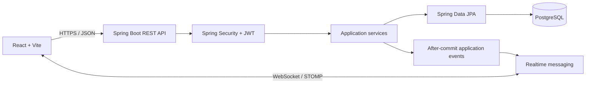

# QueueWise

QueueWise is a full-stack appointment, token, and real-time queue management system for clinics, banks, college offices, salons, and other service organizations.

It replaces fragmented paper-based queue workflows with a shared system for appointment booking, walk-in handling, counter operations, live queue visibility, role-based access, and operational analytics.

## Highlights

- Appointment booking, cancellation, check-in, and walk-in token creation.
- Multi-counter operations with service compatibility and staff assignments.
- Token lifecycle management: call, start, complete, skip, cancel, and no-show.
- Fair queue scheduling with urgent priority and starvation prevention.
- Live queue updates using Spring WebSocket and STOMP, with REST reconciliation.
- JWT authentication, role-based authorization, and organization-scoped access.
- Audit history and operational analytics.
- Transactional persistence with PostgreSQL, database constraints, and pessimistic locking.

## Technology

| Area | Stack |
|---|---|
| Backend | Java 25, Spring Boot 3.5, Spring Web, Spring Data JPA |
| Security | Spring Security, JWT, BCrypt |
| Database | PostgreSQL, Flyway |
| Frontend | React, Vite, Tailwind CSS |
| Real-time | Spring WebSocket, STOMP |
| Testing | JUnit 5, Mockito, Spring Boot Test, MockMvc, Testcontainers dependencies |
| Build and infrastructure | Maven, Docker, Docker Compose, GitHub Actions |

The frontend currently uses React rather than Vue.js. The backend is built with Spring Boot and exposes REST APIs.

## Architecture

QueueWise is structured as a modular monolith. Business capabilities are separated into focused modules while related queue and appointment operations share database transactions.



### Important engineering decisions

- **Transactional queue operations:** queue selection and lifecycle changes are performed on the server inside database transactions.
- **Concurrency control:** pessimistic write locks protect critical queue, token, and counter operations from conflicting updates.
- **After-commit updates:** real-time notifications are published after successful transaction commits, so clients are not told about rolled-back state.
- **Authoritative REST state:** WebSocket messages provide timely updates; clients can reconcile against REST endpoints.
- **Modular monolith:** avoids distributed-system complexity while the core workflows share transactional data.

## Queue scheduling

The queue engine filters candidates by queue, service compatibility, token status, arrival state, and counter availability. It combines priority with aging and deterministic tie-breakers, while protecting normal-priority customers from indefinite starvation. The selected work is revalidated under database locking before state changes are committed.

## Testing

The repository includes JUnit-based domain tests and Spring MVC/security tests. The Maven configuration also includes Spring Boot Test, MockMvc, Testcontainers, and PostgreSQL test dependencies.

Useful test areas include token and counter lifecycle rules, authentication and authorization, queue selection, concurrent staff actions, and persistence constraints. Run the test suite from the backend directory:

```bash
cd backend
mvn test
```

## Run locally

### Prerequisites

- Java 25
- Maven
- Node.js 22 and npm
- Docker Desktop / Docker Compose
- PostgreSQL (if running the backend outside Docker)

For the configured local container workflow:

```bash
cp .env.example .env
docker compose up --build
```

Check the repository's `.env.example` and Docker Compose configuration for the required local values and service ports. Never commit real credentials or signing keys. Browser-exposed `VITE_*` variables must not contain secrets.

## Repository layout

```text
QueueWise/
├── backend/                 # Spring Boot application and tests
├── frontend/                # React/Vite application
├── docs/                    # Product, architecture, API, database,
│                            # security, testing, and deployment docs
├── .github/workflows/       # CI workflow
├── docker-compose.yml
├── .env.example
└── README.md
```

## Current scope and honest limitations

- The backend uses PostgreSQL and Flyway; local/test configuration may use separate database settings.
- The frontend is React, not Vue.js.
- Docker and CI scaffolding are present. OpenShift/Kubernetes deployment is not currently implemented.
- Redis, Kafka, and cross-instance WebSocket event distribution are intentionally not claimed as implemented features.
- Production deployment and horizontal scaling require environment-specific configuration and validation.

## Documentation

See the `docs/` directory for product requirements, architecture, database design, API contracts, authentication, queue engine, token lifecycle, real-time messaging, analytics, security, error handling, testing, concurrency, performance, code standards, Git workflow, deployment, and Docker/CI decisions.
