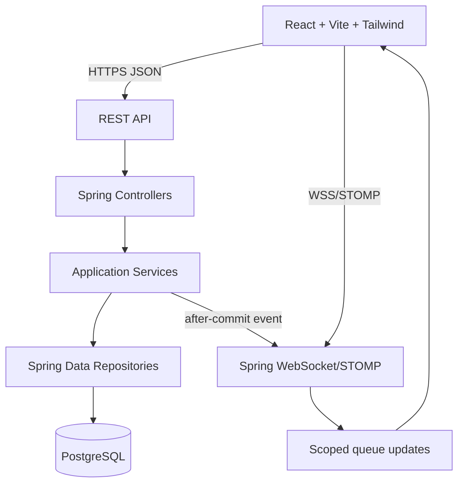
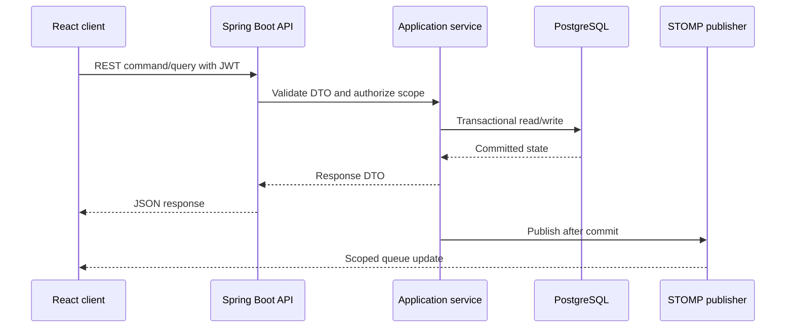
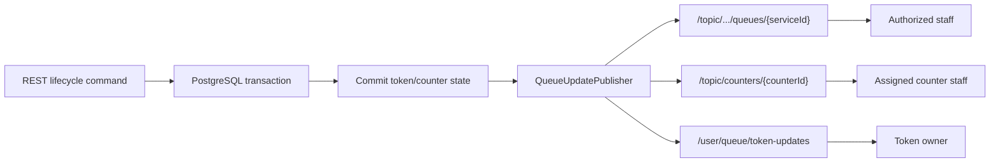

# QueueWise

QueueWise is an appointment, token, and real-time queue management system for clinics, college offices, banks, salons, and other service counters.

> QueueWise is currently in the architecture and project-foundation stage. The repository contains the product and technical design documents plus Docker/CI scaffolding; the Spring Boot and React application implementation is the next development phase.

## Problem

Service organizations often coordinate appointments and walk-ins with paper tickets, spreadsheets, verbal announcements, or disconnected tools. Customers lack reliable wait information, receptionists handle exceptions manually, and staff do not share a consistent view of queue state or counter capacity.

## Solution

QueueWise provides one operational workflow for:

- Customer appointments and walk-in tokens.
- Real-time queue position and estimated wait.
- Receptionist arrival and walk-in management.
- Staff counter operations.
- Service/counter configuration and role-based access.
- Basic analytics and append-only audit history.

The MVP favors understandable workflows and strong transactional correctness over premature distributed infrastructure.

## Features

- Customer registration and login.
- Browse active services.
- Book, monitor, and cancel appointments/tokens.
- View token history and queue estimates.
- Receptionist walk-in token creation.
- Normal and urgent priority.
- Multiple counters with service compatibility.
- Counter pause/resume.
- Staff call-next, start, complete, skip, and no-show handling.
- Appointment cancellation and no-show processing.
- Queue starvation prevention for normal customers.
- Admin service, counter, and staff management.
- Analytics for volume, wait/service times, demand, and utilization.
- JWT authentication, role/resource authorization, and audit logs.
- WebSocket/STOMP queue updates with REST reconciliation.

## User Roles

| Role | Responsibilities |
|---|---|
| Customer | Register, browse services, book appointments, receive tokens, monitor queues, cancel, and view history. |
| Receptionist | Register arrivals and create/manage walk-in tokens within assigned scope. |
| Staff | Select an assigned counter, view compatible work, call next, start, complete, or skip tokens. |
| Supervisor | Monitor assigned queues and perform authorized exception actions. |
| Admin | Manage services, counters, staff assignments, policies, analytics, and audit access. |

## Architecture

QueueWise uses a modular monolith rather than microservices. Appointment booking, token lifecycle, counter compatibility, queue selection, audit, and analytics share transactional data and are simpler to reason about in one Spring Boot application.



### Backend modules

- `authentication`: registration, login, password hashing, JWT.
- `users`: profiles, roles, organization scope, assignments.
- `services`: service catalog, hours, capacity, policies.
- `appointments`: availability, booking, cancellation, check-in.
- `tokens`: token identity and lifecycle transitions.
- `queues`: eligibility, fair scheduling, position, estimates.
- `counters`: counter state, compatibility, staff ownership.
- `notifications`: delivery records and provider adapters.
- `analytics`: PostgreSQL read queries and exports.
- `audit`: append-oriented security and business history.

## Tech Stack

| Area | Technology |
|---|---|
| Backend | Java 25, Spring Boot, Spring Web |
| Persistence | Spring Data JPA, Hibernate, PostgreSQL |
| Security | Spring Security, JWT, BCrypt/adaptive password hashing |
| Frontend | React, Vite, Tailwind CSS |
| Client data | React Query, Axios |
| Real-time | Spring WebSocket, STOMP |
| Testing | JUnit 5, Mockito, Spring Boot Test, MockMvc |
| Infrastructure | Docker, Docker Compose, GitHub Actions |

## System Design

### Request flow



### Database design

PostgreSQL stores organizations, users, roles, services, counters, compatibility joins, queues, appointments, tokens, token events, notifications, counter sessions, and audit logs.

The schema uses:

- Organization-scoped foreign keys and queries.
- Unique confirmation codes and token references.
- Partial/exclusion constraints or locked capacity rows for appointment availability.
- Unique appointment-to-token association.
- `counter_services` as the compatibility source of truth.
- Row locks/version columns for concurrent queue and lifecycle operations.
- Append-only token events and audit logs.

See [DATABASE_DESIGN.md](docs/DATABASE_DESIGN.md) for columns, constraints, relationships, indexes, and ERD.

## API Examples

Base URL: `/api/v1`

### Book an appointment

```http
POST /api/v1/appointments
Authorization: Bearer <access-token>
Content-Type: application/json
```

```json
{
  "serviceId": "service-uuid",
  "scheduledStart": "2026-09-17T10:00:00Z",
  "scheduledEnd": "2026-09-17T10:30:00Z"
}
```

A successful request returns `201 Created` with an appointment DTO and token reference. A final-slot race returns `409 CONFLICT` rather than overbooking.

### Create a walk-in token

```http
POST /api/v1/walk-ins
Authorization: Bearer <staff-access-token>
Content-Type: application/json
```

```json
{
  "customerId": "customer-uuid",
  "serviceId": "service-uuid",
  "priority": "NORMAL"
}
```

### Call the next token

```http
POST /api/v1/counters/{counterId}/call-next
Authorization: Bearer <staff-access-token>
```

The server selects an eligible compatible token atomically. The browser does not decide queue order.

### Standard error response

```json
{
  "timestamp": "2026-09-17T10:15:30Z",
  "status": 409,
  "error": "CONFLICT",
  "message": "The selected appointment slot is no longer available.",
  "path": "/api/v1/appointments",
  "correlationId": "correlation-uuid",
  "errors": []
}
```

See [API_SPECIFICATION.md](docs/API_SPECIFICATION.md) for the complete endpoint contract.

## Queue Algorithm

QueueWise does not use pure FIFO or priority-only scheduling.

1. Filter tokens by queue, service, arrival/check-in state, counter compatibility, counter status, and lifecycle status.
2. Exclude cancelled, no-show, terminal, unarrived, incompatible, and already-assigned tokens.
3. Calculate an aging score from `readyAt` plus appointment preference and priority.
4. Give urgent tokens preference during ordinary operation.
5. Protect a normal token after the configured starvation threshold.
6. Use deterministic tie-breakers: score, ready time, appointment time, then token ID.
7. Lock and recheck the selected counter/token inside a PostgreSQL transaction.

This provides urgent preference without allowing a continuous stream of urgent arrivals to starve normal customers.

## Real-Time Architecture

Spring WebSocket/STOMP publishes scoped updates after the database transaction commits.



Clients reconnect with bounded backoff and refetch authoritative REST state. WebSocket messages contain event type, IDs, status, version, and timestamp, but no unnecessary personal data.

## Screenshots

Screenshots will be added as the frontend implementation is built.

| View | Placeholder |
|---|---|
| Customer service browser | `docs/screenshots/customer-services.png` |
| Appointment booking | `docs/screenshots/appointment-booking.png` |
| Customer token status | `docs/screenshots/customer-token-status.png` |
| Staff queue console | `docs/screenshots/staff-queue.png` |
| Admin analytics | `docs/screenshots/admin-analytics.png` |

## Local Setup

### Prerequisites

- Java 25 and Maven.
- Node.js 22 and npm.
- Docker Desktop with Docker Compose.
- PostgreSQL, if running services outside Docker.

### Application source status

The repository currently contains the design documentation and Docker/CI scaffold. The expected implementation layout is:

```text
backend/
  pom.xml
  src/
frontend/
  package.json
  package-lock.json
  src/
```

After those source trees exist:

```bash
copy .env.example .env
docker compose up --build
```

The frontend is available at `http://localhost:5173` and the backend at `http://localhost:8080` by default.

## Environment Variables

Copy `.env.example` to `.env` for local development:

```text
POSTGRES_DB=queuewise
POSTGRES_USER=queuewise
POSTGRES_PASSWORD=<local-password>
SPRING_PROFILES_ACTIVE=local
JWT_ISSUER=queuewise-api
JWT_AUDIENCE=queuewise-web
JWT_SECRET=<long-random-local-secret>
CORS_ALLOWED_ORIGINS=http://localhost:5173
VITE_API_BASE_URL=http://localhost:8080/api/v1
VITE_WEBSOCKET_URL=ws://localhost:8080/ws
```

Never commit `.env`, database passwords, JWT signing keys, provider credentials, or private keys. `VITE_*` values are public browser configuration and must never contain secrets.

## Docker Setup

Compose starts:

- `postgres`: PostgreSQL with persistent named volume and health check.
- `backend`: Spring Boot image built from Java 25.
- `frontend`: Vite development container with source mounting and dependency volume.

The services share an isolated `queuewise-network`. The backend waits for PostgreSQL health; the frontend waits for backend readiness. See [DOCKER_AND_CI.md](docs/DOCKER_AND_CI.md) for a line-by-line explanation.

Useful commands:

```bash
docker compose up --build
docker compose ps
docker compose logs -f backend
docker compose down
docker compose down -v  # deletes local PostgreSQL data; use deliberately
```

## Testing

The planned testing strategy covers:

- JUnit 5 unit and policy tests.
- Mockito service tests.
- Spring Boot and MockMvc controller/security tests.
- PostgreSQL repository, migration, constraint, and locking tests.
- Queue algorithm and concurrency tests.
- WebSocket authorization/reconnect tests.
- React component, form, query-state, and frontend-flow tests.

Critical scenarios include duplicate appointment booking, simultaneous token creation, two staff members calling next, urgent handling, starvation prevention, counter compatibility, cancellation, no-show, invalid state transitions, unauthorized API access, expired JWT, and rate limiting.

## Deployment

The MVP deployment is intentionally simple:

```text
HTTPS reverse proxy
  -> frontend container/static host
  -> Spring Boot backend container
  -> managed PostgreSQL
```

GitHub Actions runs tests and builds on pull requests and pushes to `main`; it does not deploy automatically yet. Production deployment should inject secrets externally, run migrations before readiness, expose health checks, support WebSocket upgrade, and retain rollback image tags.

See [DEPLOYMENT.md](docs/DEPLOYMENT.md) and [GIT_WORKFLOW.md](docs/GIT_WORKFLOW.md).

## Project Structure

```text
QueueWise/
├── .github/workflows/ci.yml
├── backend/                  # planned Spring Boot application
│   ├── Dockerfile
│   └── src/
├── frontend/                 # planned React/Vite application
│   ├── Dockerfile
│   ├── .nvmrc
│   └── src/
├── docs/
│   ├── PRD.md
│   ├── TRD.md
│   ├── ARCHITECTURE.md
│   ├── DATABASE_DESIGN.md
│   ├── API_SPECIFICATION.md
│   ├── AUTHENTICATION.md
│   ├── QUEUE_ENGINE.md
│   ├── TOKEN_LIFECYCLE.md
│   ├── APPOINTMENT_DESIGN.md
│   ├── REALTIME_DESIGN.md
│   ├── ANALYTICS.md
│   ├── SECURITY_DESIGN.md
│   ├── ERROR_HANDLING.md
│   ├── TESTING.md
│   ├── CONCURRENCY.md
│   ├── PERFORMANCE.md
│   ├── CODE_STANDARDS.md
│   ├── GIT_WORKFLOW.md
│   ├── DEPLOYMENT.md
│   └── DOCKER_AND_CI.md
├── docker-compose.yml
├── .env.example
└── README.md
```

## Engineering Decisions

- **Modular monolith:** shared transactional workflows are simpler to operate and test than premature microservices.
- **PostgreSQL:** constraints, transactions, row locks, and relational analytics fit appointment and queue correctness.
- **REST plus WebSocket:** REST is authoritative for commands/queries; WebSocket provides timely updates.
- **JWT with Spring Security:** appropriate for a stateless Spring Boot API without requiring an OAuth2 provider.
- **DTOs:** prevent entity leakage and mass assignment.
- **Database-level concurrency:** protects final slots, token numbers, counters, and queue claims across application instances.
- **Fair queue scheduling:** urgent preference is combined with aging and a starvation threshold.
- **No premature infrastructure:** Redis, Kafka, Elasticsearch, Kubernetes, and separate services are deferred until measured needs justify them.

Detailed decisions are recorded in [ADR.md](docs/ADR.md).

## Future Improvements

- Complete the Spring Boot backend and React frontend implementation.
- Add customer and staff screenshots from working flows.
- Add email/SMS provider integration with retry monitoring.
- Add self-service kiosk and digital signage support.
- Add multi-location administration after validating the single-organization workflow.
- Add measured read projections for analytics if PostgreSQL query load requires them.
- Add horizontal backend scaling with a deliberate cross-instance WebSocket event strategy.
- Add native mobile clients only after responsive web usage validates the workflows.

## Documentation Index

- [Product Requirements](docs/PRD.md)
- [Technical Requirements](docs/TRD.md)
- [Architecture](docs/ARCHITECTURE.md)
- [Database Design](docs/DATABASE_DESIGN.md)
- [API Specification](docs/API_SPECIFICATION.md)
- [Authentication](docs/AUTHENTICATION.md)
- [Queue Engine](docs/QUEUE_ENGINE.md)
- [Token Lifecycle](docs/TOKEN_LIFECYCLE.md)
- [Appointment Design](docs/APPOINTMENT_DESIGN.md)
- [Real-Time Design](docs/REALTIME_DESIGN.md)
- [Analytics](docs/ANALYTICS.md)
- [Security Design](docs/SECURITY_DESIGN.md)
- [Error Handling](docs/ERROR_HANDLING.md)
- [Testing Strategy](docs/TESTING.md)
- [Concurrency](docs/CONCURRENCY.md)
- [Performance](docs/PERFORMANCE.md)
- [Code Standards](docs/CODE_STANDARDS.md)
- [Git Workflow](docs/GIT_WORKFLOW.md)
- [Deployment](docs/DEPLOYMENT.md)
- [Docker and CI Guide](docs/DOCKER_AND_CI.md)
