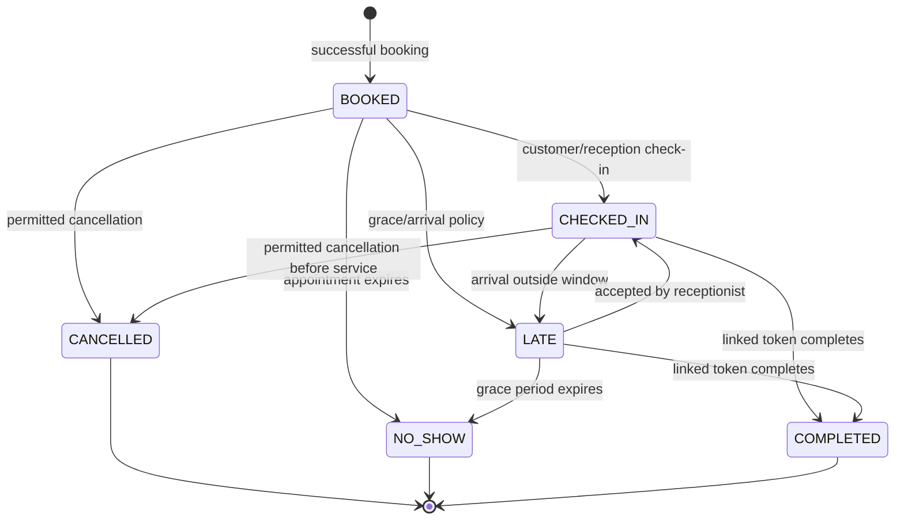

# QueueWise Appointment Design

**Version:** 1.0  
**Source of truth:** [PRD.md](PRD.md), [DATABASE_DESIGN.md](DATABASE_DESIGN.md), and [QUEUE_ENGINE.md](QUEUE_ENGINE.md)

## 1. Scope

An appointment represents a customer's reserved service time. It contains the customer, service, date/time interval, queue/business date, status, and optional token. Appointment booking does not expose JPA entities directly; the API accepts and returns DTOs.

Supported inputs:

- Customer identity.
- Service selection.
- Organization-local date and time slot.
- Service capacity and duration.
- Cancellation policy.
- Arrival/check-in policy.

An appointment is not itself proof that the customer has arrived. It becomes queue-eligible only after check-in or the configured digital-arrival action.

## 2. Appointment Lifecycle



| Status | Meaning |
|---|---|
| `BOOKED` | Slot reserved; customer has not checked in. |
| `CHECKED_IN` | Customer is present and linked token may enter `WAITING`. |
| `LATE` | Customer arrived outside the preferred window and follows late policy. |
| `CANCELLED` | Booking released or excluded from active capacity. |
| `NO_SHOW` | Customer did not arrive within the configured policy. |
| `COMPLETED` | Linked service was completed. |

Appointment status and token status are separate. A `BOOKED` appointment may have no active token; a `CHECKED_IN` appointment can have a `WAITING` token.

## 3. Booking Algorithm

`AppointmentService.book(command)` is the application transaction boundary.

```text
book(customerId, serviceId, requestedStart, requestedEnd, actor):
    validate request shape, time zone, and actor scope
    load active organization and service
    convert requested local date/time to an instant using organization time zone
    validate requested duration equals service slot policy
    lock the capacity resource for organization + service + business date + slot
    reload service hours, closure, booking horizon, and current capacity
    reject if date is closed, slot is outside hours, or slot is in the past
    reject if customer has an overlapping active appointment under policy
    reject if slot capacity is full
    obtain or lock the day's service queue
    insert appointment with BOOKED status and confirmation code
    insert linked token only if the product policy creates token at booking;
        otherwise create it during check-in
    insert appointment audit event
    commit
    request confirmation notification after commit
    return appointment DTO
```

The slot/capacity lock is the authoritative concurrency control. A preliminary availability query may improve UX, but it cannot be the final decision.

## 4. Availability Calculation

For service `S`, organization `O`, local date `D`, and slot `[start, end)`:

1. Load service status, service hours, closure dates, duration, booking horizon, and capacity.
2. Convert the requested local date/time to an instant using `O.time_zone`.
3. Confirm the slot is on an operating day and not a closure.
4. Confirm `start >= opening`, `end <= closing`, and `end > start`.
5. Confirm `end - start` matches the configured service duration or permitted slot duration.
6. Count active appointments overlapping the slot for the service and booking date.
7. Subtract cancellations and records that do not consume capacity under policy.
8. Return `remainingCapacity = slotCapacity - activeCount`.
9. Mark a slot bookable only when remaining capacity is positive and the booking horizon/cutoff rules pass.

For MVP, slots can be generated from service duration and operating hours at request time. A materialized `appointment_slots` table is optional and should be introduced only if measured availability queries are too slow.

### Capacity definition

Use half-open intervals `[scheduled_start, scheduled_end)`. An appointment ending at 10:30 does not overlap one starting at 10:30. For a capacity of one, PostgreSQL can enforce overlap with an exclusion constraint. For capacity greater than one, lock a service/date/slot capacity row or lock the relevant slot rows before counting.

## 5. Slot Validation

Server-side validation must check:

- `serviceId` is a valid UUID and belongs to the caller's organization scope.
- `scheduledStart` and `scheduledEnd` are present, parseable, and ordered.
- The requested time zone is the organization's configured IANA time zone; clients cannot silently choose another business zone.
- The requested date is within `booking_horizon_days`.
- The date is not a closure and the weekday has configured hours.
- The slot is not in the past, including a small server-side clock tolerance.
- The interval fits inside service hours.
- Duration matches service policy.
- The customer exists and is active.
- The customer does not have a conflicting active appointment when overlap is disallowed.
- Capacity is available at the final transaction check.
- The service is active and accepts bookings.

Client-side validation is only for usability. The backend and database remain authoritative.

## 6. Duplicate Booking Prevention

QueueWise prevents duplicates at multiple levels:

1. The service checks for an existing overlapping active appointment for the same customer/service.
2. The transaction locks the relevant capacity resource before checking again.
3. PostgreSQL enforces a unique confirmation code.
4. A unique partial index on `tokens.appointment_id` prevents an appointment from receiving two tokens.
5. An optional idempotency key prevents the same client retry from creating two appointments after a timeout.
6. An exclusion constraint or locked capacity row prevents two users consuming the final capacity concurrently.

A duplicate check without a database constraint is insufficient because two requests can both observe free capacity before either inserts.

## 7. Final Available Slot Race

Assume one final slot remains and users A and B submit at nearly the same time:

1. Both transactions validate the request shape.
2. The first transaction to lock the slot/capacity row obtains the lock.
3. It rechecks availability, inserts the appointment, and commits.
4. The second transaction waits for the lock.
5. After the first commit, the second transaction re-reads capacity under the transaction's isolation/locking rules.
6. It sees zero remaining capacity and returns `409 CAPACITY_UNAVAILABLE` with alternative-slot guidance.
7. No partial appointment, token, or confirmation notification is created for user B.

If both reach a PostgreSQL exclusion or unique constraint simultaneously, one insert commits and the other receives a constraint violation. The service translates that known violation into the same safe `409 CAPACITY_UNAVAILABLE` response and rolls back the losing transaction.

## 8. Transaction Boundaries

### Booking transaction

One transaction contains:

- Service and organization validation that affects the booking.
- Capacity/slot lock.
- Duplicate appointment check.
- Appointment insert.
- Queue creation or lock if required.
- Token creation when the selected policy creates tokens at booking.
- Audit event for successful booking.

Notification dispatch is after commit or uses an outbox-like `notifications` row inserted in the same transaction. Calling an external email/SMS provider inside the booking transaction is not allowed.

### Availability read

Availability is a read-only transaction or consistent read. It is advisory and must be repeated inside booking.

### Cancellation transaction

One transaction locks the appointment and associated token, checks cutoff and current states, updates appointment status, updates/cancels the token when appropriate, inserts audit/token events, and commits. Notification cancellation/suppression is processed after commit.

### Check-in transaction

One transaction locks the appointment, validates arrival window and status, changes appointment to `CHECKED_IN` or `LATE`, creates or activates its token, and writes lifecycle/audit events.

## 9. Database Constraints

The core `appointments` table uses:

```text
id uuid primary key
organization_id uuid not null references organizations(id)
customer_id uuid not null references users(id)
service_id uuid not null references services(id)
queue_id uuid not null references queues(id)
scheduled_start timestamptz not null
scheduled_end timestamptz not null
status varchar(20) not null
confirmation_code varchar(40) not null
created_at timestamptz not null default now()
updated_at timestamptz not null default now()
version bigint not null default 0
```

Required constraints and indexes:

- `scheduled_end > scheduled_start` check constraint.
- Status check constraint for supported appointment states.
- Unique `(organization_id, confirmation_code)`.
- Index `(organization_id, customer_id, scheduled_start desc)` for customer history.
- Index `(organization_id, service_id, scheduled_start, status)` for availability.
- Index `(queue_id, status, scheduled_start)` for daily operations.
- Unique partial `tokens(appointment_id) where appointment_id is not null`.
- Exclusion constraint on `tstzrange(scheduled_start, scheduled_end)` for capacity-one services, or locked capacity rows for capacity greater than one.

A production migration must choose one capacity strategy consistently. Do not deploy both competing mechanisms without defining which one is authoritative.

## 10. Appointment-to-Token Conversion

### Recommended MVP policy

Create the token at successful booking, but keep it outside active queue selection until check-in. This gives the customer a stable token reference while preventing an absent appointment from blocking walk-ins.

At booking:

- Insert appointment `BOOKED`.
- Insert token `WAITING` with `source = APPOINTMENT` but `ready_at = null` or an equivalent not-ready marker.
- Do not include the token in `callNext` until appointment check-in marks it ready.

At check-in:

- Lock appointment and token.
- Change appointment to `CHECKED_IN` or `LATE`.
- Set token `ready_at`/`arrival_at` and make it eligible.
- Add `TOKEN_READY` event and publish queue update.

If the implementation requires `tokens.arrival_at not null`, create the token at check-in instead and return the appointment's token reference only after conversion. The two policies must not be mixed.

## 11. Cancellation

### Customer cancellation

A customer may cancel their own appointment before the service cutoff. The endpoint checks ownership, status, cutoff, and whether service has started. It changes appointment to `CANCELLED` and the linked token to `CANCELLED` if it exists.

### Staff cancellation

Receptionists/supervisors may cancel within their service scope. Admin cancellation is an audited exception. A reason is required for staff/admin cancellation.

### After call or service start

Cancellation after `CALLED` or `SERVING` is normally rejected. If an organization requires an exception, it must be a separate authorized transition with a reason and audit event; it must not reuse the ordinary customer cancellation path.

## 12. No-Show Handling

A scheduled job or staff action evaluates appointments whose arrival window and grace period have elapsed. It locks the appointment, rechecks that it is still `BOOKED`/`LATE`, and then changes it to `NO_SHOW`. A linked not-ready/waiting token becomes `NO_SHOW` and is excluded from the queue.

The job must be idempotent. Running twice does not create duplicate events or modify a completed/cancelled appointment. A called token no-show is handled by the token lifecycle grace period and releases its counter.

## 13. API Use Cases

- `GET /api/v1/appointments/availability?serviceId={id}&date=YYYY-MM-DD` returns advisory slots.
- `POST /api/v1/appointments` performs the transactional booking.
- `GET /api/v1/appointments` returns scoped history.
- `GET /api/v1/appointments/{id}` returns one appointment and token summary.
- `POST /api/v1/appointments/{id}/cancel` performs policy-checked cancellation.
- A check-in endpoint or receptionist action performs appointment-to-token readiness.

All endpoints use DTOs, organization/resource authorization, safe errors, and the standard API error format.

## 14. Tests

### Availability and validation

1. Service hours produce the expected slots.
2. Closed date produces no bookable slots.
3. Past date and outside-horizon date are rejected.
4. Slot ending at closing is accepted; slot extending beyond closing is rejected.
5. Adjacent half-open appointments do not conflict.
6. Overlapping active appointment for the same customer is rejected.
7. Cancelled appointment does not consume capacity.
8. Time-zone conversion uses organization time zone, not browser local time.

### Booking and concurrency

9. Valid booking creates appointment and configured token.
10. Duplicate confirmation/idempotency request does not create two appointments.
11. Two users booking the final capacity result in exactly one success and one `409`.
12. Database exclusion/unique violation maps to a safe business error.
13. Failed token creation rolls back the appointment when token-at-booking policy is selected.
14. Notification provider failure does not roll back committed booking.

### Lifecycle and cancellation

15. Check-in makes an appointment token eligible.
16. Unchecked-in appointment is not selected by queue engine.
17. Cancellation before cutoff updates appointment and token.
18. Cancellation after cutoff is rejected without mutation.
19. Expired appointment becomes no-show exactly once.
20. Completed appointment cannot be cancelled or marked no-show.
21. Cross-organization appointment access returns safe not-found/forbidden behavior.
