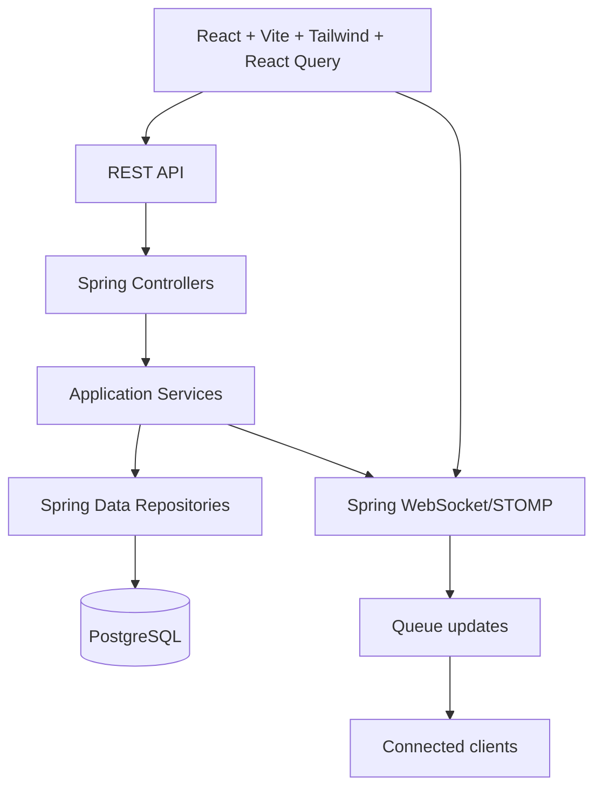
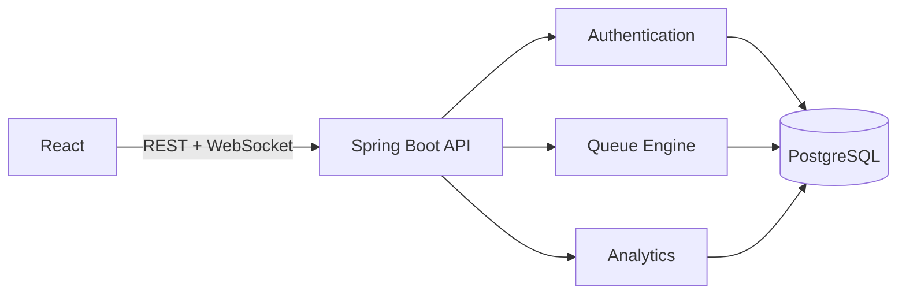
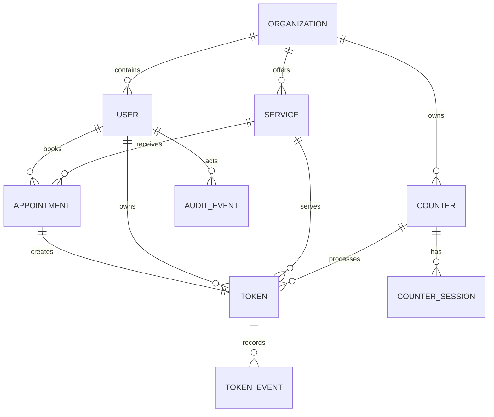
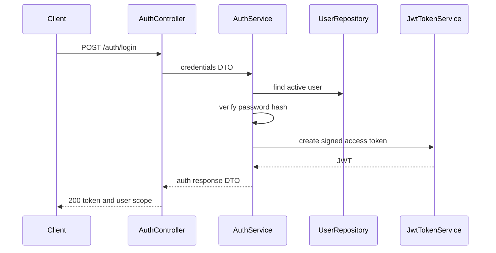
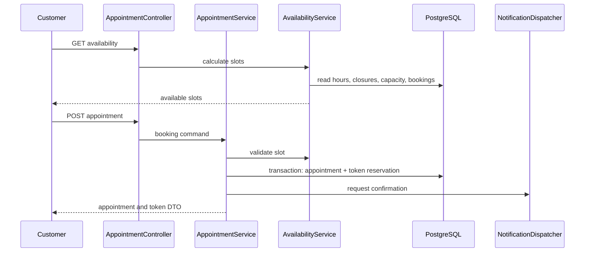
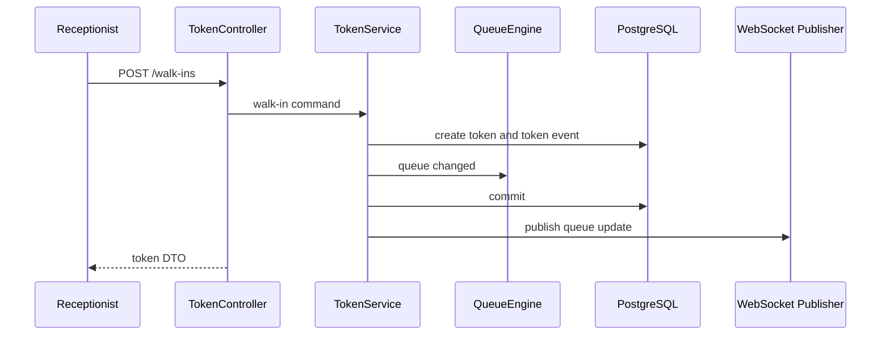
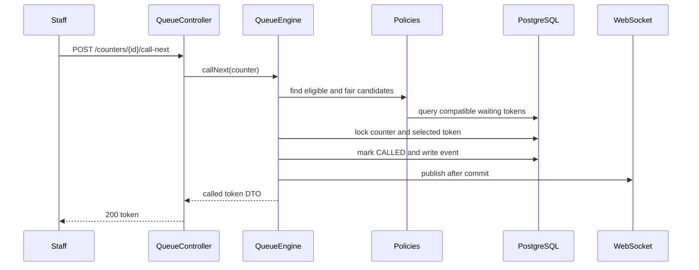
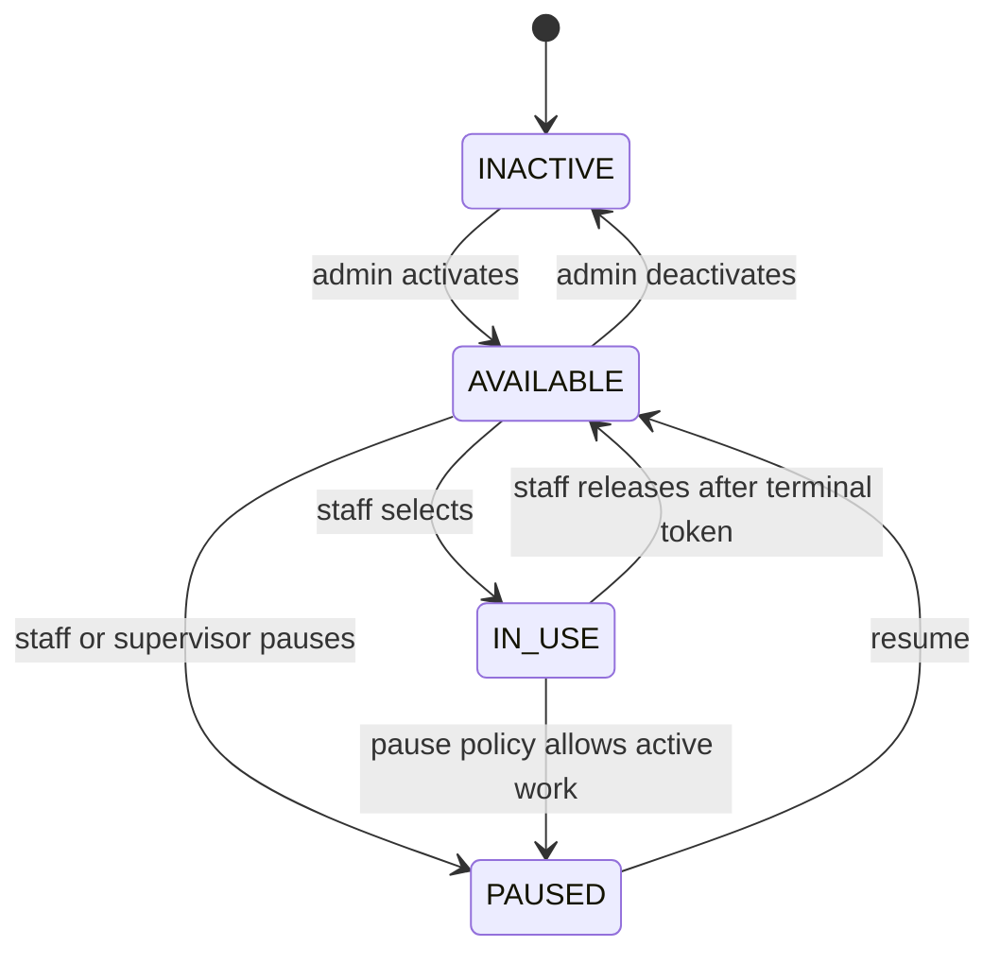
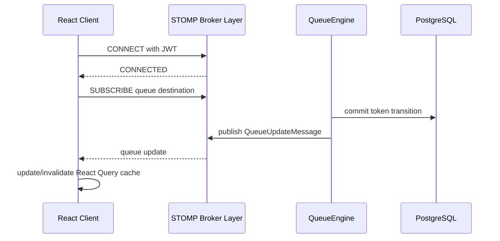
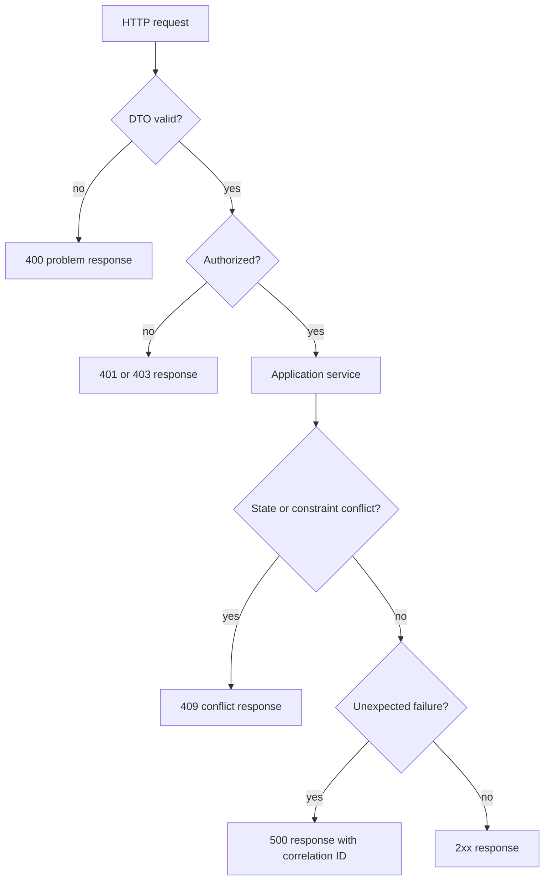

# QueueWise Software Architecture

**Version:** 1.0  
**Status:** Draft  
**Source of truth:** [PRD.md](PRD.md) and [TRD.md](TRD.md)  
**Architecture style:** Modular monolith

## 1. High-Level Architecture

QueueWise is a React frontend and a Spring Boot modular monolith backed by PostgreSQL. REST is used for commands and queries. WebSocket/STOMP delivers queue changes to authorized connected clients. The database is the source of truth for token and queue state.



The required request path is:

```text
Frontend -> REST API -> Controller -> Service -> Repository -> PostgreSQL
```

The real-time path is:

```text
WebSocket/STOMP -> authorized subscription -> queue update -> connected clients
```



The alternative flow below is intentionally rejected for the MVP:

```text
React -> API Gateway -> Auth Service -> Queue Service -> Kafka -> Notification Service -> Redis -> Analytics Service
```

It would introduce network calls, distributed transactions, message operations, multiple deployments, and infrastructure that the PRD does not require. QueueWise uses one Spring Boot process, in-process events, PostgreSQL transactions, and a database-backed notification retry approach until measured scale justifies otherwise.

## 2. Why a Modular Monolith

A modular monolith keeps the system simple while preserving boundaries. Appointment booking, token creation, queue selection, counter compatibility, and service completion share transactional rules and data. A local transaction is easier to reason about than a distributed transaction, and a single deployment is easier to test and operate for an MVP team.

Modules have explicit responsibilities and should communicate through application services, DTOs, and domain events. They must not directly reach into one another's repositories. This enables later extraction if there is evidence for independent scaling or team ownership, without paying microservice costs now.

## 3. Backend Package Structure

```text
src/main/java/com/queuewise/
  QueueWiseApplication.java
  common/
    config/                 application and persistence configuration
    exception/              typed exceptions and global handler
    web/                    API problem response and pagination
    time/                   organization-aware clock helpers
  security/
    SecurityConfig.java
    JwtAuthenticationFilter.java
    JwtTokenService.java
    CurrentUser.java
  authentication/
    web/AuthController.java
    application/AuthService.java
    domain/UserCredential.java
    persistence/UserCredentialRepository.java
  users/
    web/UserController.java
    application/UserService.java
    domain/User.java, Role.java, UserScope.java
    persistence/UserRepository.java
  services/
    web/ServiceController.java
    application/ServiceManagementService.java
    domain/ServiceDefinition.java, ServiceHours.java
    persistence/ServiceRepository.java
  appointments/
    web/AppointmentController.java
    application/AppointmentService.java, AvailabilityService.java
    domain/Appointment.java
    persistence/AppointmentRepository.java
  tokens/
    web/TokenController.java
    application/TokenService.java, TokenStateTransitionService.java
    domain/Token.java, TokenEvent.java, TokenStatus.java
    persistence/TokenRepository.java, TokenEventRepository.java
  queues/
    web/QueueController.java
    application/QueueEngine.java, WaitEstimateService.java
    domain/QueueOrderingPolicy.java, FairnessPolicy.java
    persistence/QueueEventRepository.java
  counters/
    web/CounterController.java
    application/CounterService.java, CounterAssignmentService.java
    domain/Counter.java, CounterStatus.java
    persistence/CounterRepository.java
  notifications/
    application/NotificationDispatcher.java
    domain/Notification.java, NotificationPreference.java
    infrastructure/NotificationProvider.java
    persistence/NotificationRepository.java
  analytics/
    web/AnalyticsController.java
    application/AnalyticsQueryService.java
    persistence/AnalyticsRepository.java
  audit/
    application/AuditService.java, AuditEventListener.java
    domain/AuditEvent.java
    persistence/AuditEventRepository.java
  websocket/
    WebSocketConfig.java
    QueueUpdatePublisher.java
    QueueUpdateMessage.java
```

Controllers should be thin. Services own use cases and transaction boundaries. Repositories own persistence queries. Entities own persistence state and simple invariants; policy classes own complex ordering decisions. Mappers convert between entities and DTOs.

## 4. Frontend Structure

```text
src/
  app/
    App.tsx
    router.tsx
    providers.tsx
  api/
    axiosClient.ts
    authApi.ts
    appointmentApi.ts
    queueApi.ts
    adminApi.ts
  components/
    Button.tsx, FormField.tsx, Modal.tsx, StatusBadge.tsx
  features/
    auth/
    customer/
      ServiceBrowser.tsx, BookingForm.tsx, TokenStatus.tsx, HistoryPage.tsx
    receptionist/
      WalkInForm.tsx
    staff/
      CounterSelector.tsx, StaffQueue.tsx, ServiceControls.tsx
    admin/
      ServiceManagement.tsx, CounterManagement.tsx, StaffManagement.tsx
      AnalyticsPage.tsx, AuditLogPage.tsx
    queue/
      QueueList.tsx, QueuePosition.tsx, useQueueUpdates.ts
  layouts/
    CustomerLayout.tsx, StaffLayout.tsx, AdminLayout.tsx
  routes/
    ProtectedRoute.tsx, RoleRoute.tsx
  types/
    api.ts, auth.ts, queue.ts
  styles/
    index.css
```

React Query owns server state and cache invalidation. Axios handles HTTP and normalized errors. A WebSocket hook invalidates or updates relevant queries after a verified server message. The browser never decides which token is next.

## 5. Module Design

### 5.1 Authentication

**Responsibility:** Registration, login, password hashing, JWT issuance, session/logout policy, and authentication events.

**Classes:** `AuthController`, `AuthService`, `PasswordService`, `JwtTokenService`, `JwtAuthenticationFilter`, `SecurityConfig`.

**Dependencies:** Users for account identity; audit for security events; Spring Security; JWT library selected for the project.

**Data owned:** Credentials, password hash, account status, token metadata if refresh tokens are enabled.

**APIs:** `POST /api/v1/auth/register`, `POST /api/v1/auth/login`, `POST /api/v1/auth/logout`.

**Events:** `UserRegistered`, `UserLoggedIn`, `UserLoggedOut`, `AuthenticationFailed`.

**Tables:** `users`, `user_credentials`, optional `refresh_tokens`.

### 5.2 Users

**Responsibility:** Profiles, roles, organization scope, staff status, and staff assignments.

**Classes:** `UserController`, `UserService`, `User`, `Role`, `UserScope`, `StaffAssignmentService`.

**Dependencies:** Authentication identity; services and counters for assignment; audit.

**Data owned:** User profile, role, active status, organization, service/counter assignment.

**APIs:** Admin staff CRUD, scoped `GET /users/me`.

**Events:** `StaffAssigned`, `StaffDeactivated`, `RoleChanged`.

**Tables:** `users`, `user_roles`, `staff_services`, `staff_counters`.

### 5.3 Services

**Responsibility:** Service catalog and business configuration used by booking and queue selection.

**Classes:** `ServiceController`, `ServiceManagementService`, `ServiceDefinition`, `ServiceHours`, `ServiceMapper`.

**Dependencies:** Users/admin authorization; counters for compatibility; audit; notifications for policy settings.

**Data owned:** Name, instructions, active state, duration, hours, booking horizon, capacity, grace period, cancellation cutoff, priority and notification policy.

**APIs:** Customer service browsing; admin service CRUD and configuration.

**Events:** `ServiceCreated`, `ServiceUpdated`, `ServiceDeactivated`.

**Tables:** `services`, `service_hours`, `service_closures`, `service_policies`.

### 5.4 Appointments

**Responsibility:** Slot availability, appointment booking, cancellation, check-in, late policy, and appointment history.

**Classes:** `AppointmentController`, `AppointmentService`, `AvailabilityService`, `AppointmentMapper`.

**Dependencies:** Services for hours/capacity; tokens for token association; users for customer ownership; audit and notifications.

**Data owned:** Customer, service, date/time, status, booking and cancellation timestamps, token reference.

**APIs:** `GET /appointments/availability`, `POST /appointments`, `GET /appointments`, `POST /appointments/{id}/cancel`.

**Events:** `AppointmentBooked`, `AppointmentCancelled`, `AppointmentCheckedIn`, `AppointmentExpired`.

**Tables:** `appointments`, `appointment_slots` only if materialized capacity is needed.

### 5.5 Tokens

**Responsibility:** Token identity, source, priority, status transitions, lifecycle history, and idempotent commands.

**Classes:** `TokenController`, `TokenService`, `TokenStateTransitionService`, `Token`, `TokenEvent`.

**Dependencies:** Services for ownership; appointments for booked tokens; queues for eligibility; counters for assignment; audit and notifications.

**Data owned:** Token reference, source, priority, service, customer, appointment, status, timestamps, assigned counter.

**APIs:** Customer token status/history, receptionist `POST /walk-ins`, cancellation, start, complete, and skip commands.

**Events:** `TokenCreated`, `TokenPriorityChanged`, `TokenCalled`, `ServiceStarted`, `ServiceCompleted`, `TokenSkipped`, `TokenNoShow`, `TokenCancelled`.

**Tables:** `tokens`, `token_events`.

### 5.6 Queues

**Responsibility:** Eligibility, ordering, fairness, atomic call-next, queue position, and wait estimates.

**Classes:** `QueueController`, `QueueEngine`, `EligibilityPolicy`, `PriorityPolicy`, `AppointmentPolicy`, `FairnessPolicy`, `WaitEstimateService`.

**Dependencies:** Tokens, services, counters, appointments, organization clock, WebSocket publisher.

**Data owned:** Queue events and optional materialized queue snapshots; token state remains owned by tokens.

**APIs:** `GET /queues`, `POST /counters/{id}/call-next`.

**Events:** `QueueChanged`, `TokenCalled`, `WaitEstimateChanged`.

**Tables:** `queue_events`; indexes on active token service, status, priority, arrival time, and appointment window.

### 5.7 Counters

**Responsibility:** Counter configuration, service compatibility, staff selection, pause/resume, and counter sessions.

**Classes:** `CounterController`, `CounterService`, `CounterAssignmentService`, `Counter`, `CounterSession`.

**Dependencies:** Users for staff assignment; services for compatibility; queues for call eligibility; audit.

**Data owned:** Counter identity, location, status, compatible services, current staff, pause reason, session times.

**APIs:** Admin counter CRUD; staff select/release; pause/resume; counter view.

**Events:** `CounterSelected`, `CounterReleased`, `CounterPaused`, `CounterResumed`.

**Tables:** `counters`, `counter_services`, `counter_sessions`.

### 5.8 Notifications

**Responsibility:** Preferences, templates, scheduling, delivery status, retries, and provider abstraction.

**Classes:** `NotificationDispatcher`, `NotificationProvider`, `EmailNotificationProvider`, optional `SmsNotificationProvider`, `NotificationRepository`.

**Dependencies:** Tokens, appointments, users, configured provider credentials, audit for administrative changes.

**Data owned:** Recipient, channel, template, trigger, status, attempts, provider reference, timestamps.

**APIs:** Admin notification policy; customer preferences; notification status where permitted.

**Events:** `NotificationRequested`, `NotificationSent`, `NotificationFailed`.

**Tables:** `notification_preferences`, `notifications`, `notification_templates` if templates are stored.

### 5.9 Analytics

**Responsibility:** Authorized operational metrics and exports.

**Classes:** `AnalyticsController`, `AnalyticsQueryService`, `AnalyticsRepository`, `AnalyticsMapper`.

**Dependencies:** Read-only queries over appointments, tokens, token events, counter sessions, notifications, and authorization scope.

**Data owned:** No duplicate source-of-truth state in MVP; optional PostgreSQL projections may be added after measurement.

**APIs:** `GET /analytics/summary`, `GET /analytics/timeseries`, `GET /analytics/export`.

**Events:** None required for the initial query-based design; metrics derive from committed records.

**Tables:** Reads `appointments`, `tokens`, `token_events`, `counter_sessions`, `notifications`; optional `analytics_daily_summary` later.

### 5.10 Audit

**Responsibility:** Append-oriented security, configuration, and business lifecycle history.

**Classes:** `AuditService`, `AuditEventListener`, `AuditQueryService`, `AuditEvent`.

**Dependencies:** Events from all modules; current actor and organization scope.

**Data owned:** Actor, action, target, before/after summary where safe, reason, outcome, timestamp, correlation ID.

**APIs:** Admin `GET /audit-events` with scoped filters.

**Events:** Consumes security, configuration, appointment, token, counter, and notification events.

**Tables:** `audit_events`.

## 6. Database Relationship Overview



All relationships are organization-scoped. Historical entities are deactivated rather than deleted when deletion would break audit or analytics history.

## 7. Request Lifecycle

1. React submits a request through Axios.
2. The browser sends the JWT access token.
3. Spring Security validates signature, expiry, and claims.
4. Controller validates the request DTO and maps it to an application command.
5. The application service checks role and resource scope.
6. The service starts a transaction where state changes are required.
7. Repositories read or write PostgreSQL entities.
8. Domain events are recorded or published after successful commit.
9. The service maps the result to a response DTO.
10. The controller returns a JSON response with status and correlation ID.
11. React Query updates or invalidates the relevant cache.

## 8. Authentication Flow



The client stores tokens according to the selected security strategy. Every later request is authenticated and resource-scoped. Password hashes are never returned.

## 9. Appointment Booking Flow



The final slot check occurs inside the transaction to prevent duplicate booking. Notification failure does not roll back a successful booking.

## 10. Token Creation Flow

For an appointment, the booking transaction creates or associates the token. For a walk-in, the receptionist sends service, customer, source, and priority to the token application service. The service validates authorization, creates a unique reference, sets `WAITING`, writes a token event, and publishes a queue change after commit.



## 11. Queue Processing Flow



The selection order considers urgent priority, appointment policy, arrival time, counter compatibility, and the normal-token starvation threshold. Paused counters are ineligible. The token claim is atomic and retried only within a bounded concurrency policy.

## 12. Service Completion Flow

1. Staff sends `start` for the called token.
2. The token service verifies that the token belongs to the selected counter and is `CALLED`.
3. The transaction changes it to `IN_SERVICE` and records start time.
4. Staff sends `complete` or `skip`.
5. The service verifies actor, counter, and current state.
6. Completion records end time and changes the token to `COMPLETED`; skip records a required reason and changes it to `SKIPPED`.
7. Audit, analytics source events, customer status, notification, and queue update are produced after commit.

A repeated request returns the current state or a controlled conflict rather than applying the lifecycle change twice.

## 13. Counter Lifecycle Flow



A counter cannot call tokens while paused or while it has an active token. Compatibility is checked against the service-to-counter relationship on every call, not only when the staff screen loads.

## 14. WebSocket Update Flow

1. The client authenticates a STOMP connection.
2. The server validates the JWT and authorizes the requested organization/service/counter destination.
3. The client subscribes to its queue and token destinations.
4. A committed queue or token event is mapped to a small update message.
5. The publisher sends the message to authorized destinations.
6. The client updates or invalidates React Query data.
7. If the connection drops, the client reconnects and refetches authoritative REST state.



Spring's in-process broker is sufficient for a single application instance. If horizontal scaling is introduced, the deployment must add a deliberate cross-instance WebSocket event strategy; it must not be assumed automatically.

## 15. Analytics Flow

1. Admin requests a date range and filters.
2. `AnalyticsController` validates filters and scope.
3. `AnalyticsQueryService` queries indexed PostgreSQL records.
4. The service calculates counts, wait/service durations, no-shows, cancellations, priorities, sources, and utilization.
5. The response mapper returns a summary or export DTO.
6. Authorization filters are applied before results are returned.

Analytics does not mutate queue state and does not run inside the token transition transaction.

## 16. Error Flow



`@RestControllerAdvice` maps known exceptions to stable error codes and field errors. Unknown exceptions are logged with correlation ID and returned as a generic message. Transactions roll back failed commands. The frontend displays safe messages and preserves the user's unsaved input where possible.

## 17. Dependency Rules

- Controllers depend on application services, DTOs, and mappers only.
- Application services may depend on repositories, policies, mappers, and module contracts.
- Repositories depend on entities and persistence queries only.
- Queue policies are pure or database-query oriented and must be unit-testable.
- Modules communicate through public application interfaces and events, not private repository access.
- Analytics is read-only against operational data.
- Audit consumes events and does not control the originating transaction's business decision.
- Infrastructure adapters, such as notification providers, are behind interfaces.

## 18. Architectural Quality Rules

- Use one transaction boundary for each business command that changes related state.
- Use DTOs at every external API boundary.
- Validate at the API, application, and database boundaries appropriate to the rule.
- Keep token lifecycle transitions explicit and auditable.
- Make retries idempotent where network clients may repeat a request.
- Prefer PostgreSQL constraints and indexes over in-memory assumptions.
- Do not add Kafka, Redis, microservices, or a separate API gateway without measured requirements and an approved architecture change.
