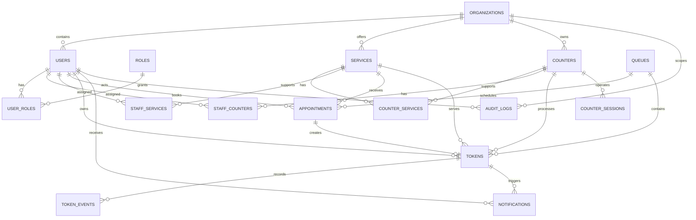

# QueueWise PostgreSQL Database Design

**Version:** 1.0  
**Source of truth:** [PRD.md](PRD.md) and [TRD.md](TRD.md)  
**Database:** PostgreSQL

## 1. Design Principles

- PostgreSQL is the authoritative store for operational state.
- Every business row is scoped to an `organization_id`.
- IDs are UUIDs generated by PostgreSQL or the application; public IDs are not sequential business references.
- Statuses are stored as constrained `varchar` values mapped to Java enums, not separate entities, because the values are small, code-owned, and do not need independent metadata.
- Many-to-many relationships use join tables with composite primary keys.
- Historical appointments, tokens, and audit logs are retained; deactivation is preferred to deletion.
- Queue selection and token creation use transactions, unique constraints, and row locks.
- Analytics reads normalized operational data through indexed queries; no duplicate analytics store is needed for MVP.

## 2. Entity Decisions

### Notification
A separate entity is necessary. Delivery has independent state, retry count, provider reference, recipient, channel, and timestamps. A notification failure must not roll back booking or queue work.

### TokenStatus
Not a separate entity. Use a Java enum and constrained `varchar` on `tokens.status`; lifecycle history belongs in `token_events`.

### AppointmentStatus
Not a separate entity. Use a Java enum and constrained `varchar` on `appointments.status`; statuses have no configurable metadata in MVP.

### CounterStatus
Not a separate entity. Use a Java enum and constrained `varchar` on `counters.status`. Pause details are columns on `counters` or `counter_sessions`.

### ServiceStatus
Not a separate entity. Use a Java enum and constrained `varchar` on `services.status`. A service's configuration is relational data, not a status catalog.

## 3. Common Conventions

- `id uuid primary key default gen_random_uuid()`.
- `created_at timestamptz not null default now()`.
- `updated_at timestamptz not null default now()` where mutable.
- `version bigint not null default 0` on concurrently updated aggregates.
- `organization_id uuid not null` on organization-owned tables.
- `citext` or a normalized lowercase value for case-insensitive email uniqueness.
- `timestamptz` for instants; `date` for business dates; `time` for local operating hours.
- Foreign keys use `on delete restrict` for historical entities. Join rows may use `on delete cascade` only when deleting the parent is already allowed.

## 4. Relationship Summary



## 5. Organizations

Although not in the minimum list, this table is required to scope users, services, counters, queues, and audit data safely.

**Table:** `organizations`

| Column | PostgreSQL type | Null/default | Constraints |
|---|---|---|---|
| `id` | `uuid` | not null / `gen_random_uuid()` | primary key |
| `name` | `varchar(160)` | not null | unique with normalized name within deployment policy |
| `slug` | `varchar(100)` | not null | unique |
| `time_zone` | `varchar(64)` | not null / `UTC` | valid IANA zone validated by application |
| `status` | `varchar(20)` | not null / `ACTIVE` | `ACTIVE`, `INACTIVE` |
| `created_at` | `timestamptz` | not null / `now()` |  |
| `updated_at` | `timestamptz` | not null / `now()` |  |

**Indexes:** unique `slug`; `status` if organization administration filters by status.

## 6. Users

**Table:** `users`

| Column | PostgreSQL type | Null/default | Constraints |
|---|---|---|---|
| `id` | `uuid` | not null / generated | primary key |
| `organization_id` | `uuid` | not null | FK `organizations(id)` |
| `email` | `citext` | nullable | unique with organization when present |
| `phone` | `varchar(32)` | nullable | normalized value; unique with organization when present |
| `password_hash` | `varchar(255)` | not null | never plaintext |
| `first_name` | `varchar(80)` | not null |  |
| `last_name` | `varchar(80)` | not null |  |
| `status` | `varchar(20)` | not null / `ACTIVE` | `ACTIVE`, `INACTIVE`, `LOCKED` |
| `last_login_at` | `timestamptz` | nullable |  |
| `created_at` | `timestamptz` | not null / `now()` |  |
| `updated_at` | `timestamptz` | not null / `now()` |  |
| `version` | `bigint` | not null / `0` | optimistic locking |

**Constraints:** at least one of `email` or `phone` must be present; partial unique indexes enforce non-null contact uniqueness per organization. Foreign key uses restrict.

**Indexes:** `(organization_id, status)` for staff/admin lists; partial unique `(organization_id, email) where email is not null`; partial unique `(organization_id, phone) where phone is not null`.

**Relationships:** one organization has many users; one user can own many appointments, tokens, notifications, and audit actions.

## 7. Roles and User Roles

**Table:** `roles`

| Column | PostgreSQL type | Null/default | Constraints |
|---|---|---|---|
| `id` | `uuid` | not null / generated | primary key |
| `code` | `varchar(40)` | not null | unique, e.g. `CUSTOMER`, `STAFF`, `ADMIN` |
| `description` | `varchar(255)` | not null |  |

**Table:** `user_roles`

| Column | PostgreSQL type | Null/default | Constraints |
|---|---|---|---|
| `user_id` | `uuid` | not null | FK `users(id)` |
| `role_id` | `uuid` | not null | FK `roles(id)` |
| `assigned_at` | `timestamptz` | not null / `now()` |  |
| `assigned_by` | `uuid` | nullable | FK `users(id)` |

**Primary key:** `(user_id, role_id)`.

**Indexes:** `(role_id, user_id)` for role-scoped staff queries; `(assigned_by)` only if assignment audit queries require it.

**Relationships:** users and roles are many-to-many. `user_roles` prevents duplicate role assignment. Role rows are seeded reference data, not created by ordinary admins.

## 8. Services

**Table:** `services`

| Column | PostgreSQL type | Null/default | Constraints |
|---|---|---|---|
| `id` | `uuid` | not null / generated | primary key |
| `organization_id` | `uuid` | not null | FK organizations |
| `name` | `varchar(160)` | not null | unique within organization |
| `description` | `text` | nullable |  |
| `instructions` | `text` | nullable |  |
| `status` | `varchar(20)` | not null / `ACTIVE` | `ACTIVE`, `INACTIVE` |
| `estimated_duration_seconds` | `integer` | not null | > 0 |
| `booking_horizon_days` | `smallint` | not null / `30` | >= 0 |
| `slot_capacity` | `smallint` | not null / `1` | > 0 |
| `grace_period_minutes` | `smallint` | not null / `15` | >= 0 |
| `cancellation_cutoff_minutes` | `integer` | not null / `60` | >= 0 |
| `created_at` | `timestamptz` | not null / `now()` |  |
| `updated_at` | `timestamptz` | not null / `now()` |  |
| `version` | `bigint` | not null / `0` |  |

**Indexes:** unique `(organization_id, lower(name))`; `(organization_id, status)` for browsing; `(organization_id, created_at)` for administration.

**Relationships:** one service has many appointments, tokens, service hours, compatible counters, and assigned staff.

**Related table:** `service_hours` stores `service_id`, `day_of_week smallint`, `opens_at time`, `closes_at time`, and `is_closed boolean not null default false`; primary key `(service_id, day_of_week)`, FK to services, index `(service_id, day_of_week)`.

## 9. Counters

**Table:** `counters`

| Column | PostgreSQL type | Null/default | Constraints |
|---|---|---|---|
| `id` | `uuid` | not null / generated | primary key |
| `organization_id` | `uuid` | not null | FK organizations |
| `name` | `varchar(80)` | not null | unique within organization |
| `location_label` | `varchar(120)` | nullable |  |
| `status` | `varchar(20)` | not null / `AVAILABLE` | `INACTIVE`, `AVAILABLE`, `IN_USE`, `PAUSED` |
| `pause_reason` | `varchar(255)` | nullable | required while paused by application/check constraint |
| `current_staff_id` | `uuid` | nullable | FK users |
| `created_at` | `timestamptz` | not null / `now()` |  |
| `updated_at` | `timestamptz` | not null / `now()` |  |
| `version` | `bigint` | not null / `0` | optimistic/locking |

**Indexes:** unique `(organization_id, lower(name))`; `(organization_id, status)` for available/paused counters; `(current_staff_id)` for release and lookup.

**Relationships:** one organization has many counters; one counter supports many services through `counter_services`, has many staff assignments, processes many tokens historically, and has many counter sessions.

## 10. CounterService

**Table:** `counter_services`

| Column | PostgreSQL type | Null/default | Constraints |
|---|---|---|---|
| `counter_id` | `uuid` | not null | FK counters on delete cascade |
| `service_id` | `uuid` | not null | FK services on delete cascade |
| `created_at` | `timestamptz` | not null / `now()` |  |

**Primary key:** `(counter_id, service_id)`.

**Indexes:** `(service_id, counter_id)` to find all compatible counters during queue selection.

**Relationship:** counters and services are many-to-many. This table is the authoritative compatibility rule and prevents a counter from calling an incompatible token.

## 11. Staff Assignments

Required for the PRD's staff/service and staff/counter scope.

**Tables:** `staff_services(user_id, service_id, assigned_at, assigned_by)` and `staff_counters(user_id, counter_id, assigned_at, assigned_by)`.

Each has a composite primary key, foreign keys to users and the assigned entity, and indexes in the reverse lookup direction. These are many-to-many relationships: a staff member may handle several services/counters, and each service/counter may have several staff members.

## 12. Queues

A queue is a logical daily queue for one service. It is not a duplicated list of token rows; tokens remain the source of truth.

**Table:** `queues`

| Column | PostgreSQL type | Null/default | Constraints |
|---|---|---|---|
| `id` | `uuid` | not null / generated | primary key |
| `organization_id` | `uuid` | not null | FK organizations |
| `service_id` | `uuid` | not null | FK services |
| `business_date` | `date` | not null | organization-local date |
| `status` | `varchar(20)` | not null / `OPEN` | `OPEN`, `PAUSED`, `CLOSED` |
| `created_at` | `timestamptz` | not null / `now()` |  |
| `updated_at` | `timestamptz` | not null / `now()` |  |
| `version` | `bigint` | not null / `0` |  |

**Unique constraint:** `(organization_id, service_id, business_date)`.

**Indexes:** `(organization_id, business_date, status)`; `(service_id, business_date)`.

**Relationship:** one queue has many appointments and tokens for one service/date. A queue status can explain why no token is eligible without changing token history.

## 13. Appointments

**Table:** `appointments`

| Column | PostgreSQL type | Null/default | Constraints |
|---|---|---|---|
| `id` | `uuid` | not null / generated | primary key |
| `organization_id` | `uuid` | not null | FK organizations |
| `customer_id` | `uuid` | not null | FK users |
| `service_id` | `uuid` | not null | FK services |
| `queue_id` | `uuid` | not null | FK queues |
| `scheduled_start` | `timestamptz` | not null |  |
| `scheduled_end` | `timestamptz` | not null | > start |
| `status` | `varchar(20)` | not null / `BOOKED` | `BOOKED`, `CHECKED_IN`, `LATE`, `CANCELLED`, `NO_SHOW`, `COMPLETED` |
| `confirmation_code` | `varchar(40)` | not null | unique within organization |
| `cancelled_at` | `timestamptz` | nullable |  |
| `created_at` | `timestamptz` | not null / `now()` |  |
| `updated_at` | `timestamptz` | not null / `now()` |  |
| `version` | `bigint` | not null / `0` |  |

**Indexes:** `(organization_id, customer_id, scheduled_start desc)` for history; `(organization_id, service_id, scheduled_start, status)` for availability; `(queue_id, status, scheduled_start)` for daily operations; unique `(organization_id, confirmation_code)`.

**Preventing duplicate appointments:** the application checks overlap and capacity inside a transaction, but the final database protection should use a PostgreSQL exclusion constraint where appointment intervals are bookable resources, for example a `tstzrange(scheduled_start, scheduled_end)` exclusion by `(organization_id, customer_id, service_id)` for statuses that consume capacity. For slot-capacity services greater than one, use an advisory/row lock on the service/date slot or a materialized `appointment_slots` capacity row with `select for update`. Do not rely on a pre-check alone.

**Relationships:** a customer can have many appointments; a service and queue can have many appointments; an appointment has zero or one token through a unique `appointment_id` on tokens.

## 14. Tokens

**Table:** `tokens`

| Column | PostgreSQL type | Null/default | Constraints |
|---|---|---|---|
| `id` | `uuid` | not null / generated | primary key |
| `organization_id` | `uuid` | not null | FK organizations |
| `queue_id` | `uuid` | not null | FK queues |
| `service_id` | `uuid` | not null | FK services |
| `customer_id` | `uuid` | not null | FK users |
| `appointment_id` | `uuid` | nullable | FK appointments, unique when not null |
| `assigned_counter_id` | `uuid` | nullable | FK counters |
| `token_number` | `integer` | not null | unique within queue |
| `display_code` | `varchar(30)` | not null | unique within queue/business date |
| `source` | `varchar(20)` | not null | `APPOINTMENT`, `WALK_IN` |
| `priority` | `varchar(20)` | not null / `NORMAL` | `NORMAL`, `URGENT` |
| `status` | `varchar(20)` | not null | lifecycle constraint |
| `arrival_at` | `timestamptz` | not null / `now()` |  |
| `called_at` | `timestamptz` | nullable |  |
| `service_started_at` | `timestamptz` | nullable |  |
| `service_completed_at` | `timestamptz` | nullable |  |
| `terminal_reason` | `varchar(255)` | nullable | required for skip/no-show where applicable |
| `created_at` | `timestamptz` | not null / `now()` |  |
| `updated_at` | `timestamptz` | not null / `now()` |  |
| `version` | `bigint` | not null / `0` | optimistic locking |

**Unique constraints:** `(queue_id, token_number)`; `(queue_id, display_code)`; partial unique `(appointment_id) where appointment_id is not null`.

**Indexes:** `(queue_id, status, priority, arrival_at, id)` for queue lookup; `(organization_id, customer_id, created_at desc)` for customer history; `(assigned_counter_id, status)` for active counter work; `(service_id, status, arrival_at)` for operations; `(appointment_id)`.

**Concurrent creation:** allocate `token_number` by locking the queue row (`select for update`) and incrementing a queue counter, or by inserting with a database sequence scoped by business date. Handle unique violations with a bounded retry. UUID identity alone does not replace human-readable number uniqueness.

**Relationships:** a token belongs to one queue, service, organization, and customer; it optionally belongs to one appointment and one currently assigned counter; a counter and service can process many tokens over time.

## 15. Token Events

**Table:** `token_events`

| Column | Type | Null/default | Constraints |
|---|---|---|---|
| `id` | `bigint` | not null / identity | primary key |
| `token_id` | `uuid` | not null | FK tokens |
| `organization_id` | `uuid` | not null | FK organizations |
| `actor_user_id` | `uuid` | nullable | FK users; null for system |
| `event_type` | `varchar(40)` | not null | event code |
| `from_status` | `varchar(20)` | nullable |  |
| `to_status` | `varchar(20)` | nullable |  |
| `reason` | `varchar(255)` | nullable |  |
| `metadata` | `jsonb` | not null / `{}` | non-sensitive details only |
| `created_at` | `timestamptz` | not null / `now()` |  |

**Indexes:** `(token_id, created_at)` for lifecycle history; `(organization_id, created_at)` for analytics/audit-like operational queries; `(event_type, created_at)`.

This append-only table provides token auditability without turning every status into a separate entity.

## 16. Audit Logs

**Table:** `audit_logs`

| Column | PostgreSQL type | Null/default | Constraints |
|---|---|---|---|
| `id` | `bigint` | not null / identity | primary key |
| `organization_id` | `uuid` | not null | FK organizations |
| `actor_user_id` | `uuid` | nullable | FK users; null for system |
| `action` | `varchar(80)` | not null |  |
| `entity_type` | `varchar(60)` | not null |  |
| `entity_id` | `uuid` | nullable | target identifier |
| `outcome` | `varchar(20)` | not null | `SUCCESS`, `FAILURE` |
| `reason` | `varchar(255)` | nullable |  |
| `before_data` | `jsonb` | nullable | redacted safe fields |
| `after_data` | `jsonb` | nullable | redacted safe fields |
| `correlation_id` | `varchar(64)` | nullable | request trace |
| `ip_address` | `inet` | nullable | policy-controlled |
| `created_at` | `timestamptz` | not null / `now()` | append-only |

**Indexes:** `(organization_id, created_at desc)` for audit browsing; `(organization_id, actor_user_id, created_at desc)`; `(organization_id, entity_type, entity_id, created_at)`; `(correlation_id)`.

Audit rows are not updated or deleted by application users. JSON fields must exclude passwords, JWTs, secrets, and unnecessary personal data.

Audit writes are append-only and occur in a separate transaction after the business
The action column is a stable application event code rather than a database enum, so new
audit actions can be deployed without a table migration. The application enum remains the
allow-list for supported actions, while PostgreSQL retains historical rows if an action is
transaction commits. This prevents rolled-back commands from producing successful audit
records, while the indexed organization, actor, entity, timestamp, and correlation fields
keep administrative investigation queries bounded. The application must retain a separate
database/migration permission policy if regulatory retention requires archive or purge jobs;
ordinary application users do not receive update or delete access.

## 17. Notifications

**Table:** `notifications`

| Column | PostgreSQL type | Null/default | Constraints |
|---|---|---|---|
| `id` | `uuid` | not null / generated | primary key |
| `organization_id` | `uuid` | not null | FK organizations |
| `recipient_user_id` | `uuid` | not null | FK users |
| `token_id` | `uuid` | nullable | FK tokens |
| `appointment_id` | `uuid` | nullable | FK appointments |
| `channel` | `varchar(20)` | not null | `IN_APP`, `EMAIL`, `SMS` |
| `notification_type` | `varchar(40)` | not null | confirmation/reminder/called |
| `status` | `varchar(20)` | not null / `PENDING` | `PENDING`, `SENT`, `FAILED`, `CANCELLED` |
| `provider_reference` | `varchar(160)` | nullable |  |
| `attempt_count` | `smallint` | not null / `0` | >= 0 |
| `next_attempt_at` | `timestamptz` | nullable |  |
| `sent_at` | `timestamptz` | nullable |  |
| `last_error_code` | `varchar(80)` | nullable | safe provider code only |
| `created_at` | `timestamptz` | not null / `now()` |  |

**Indexes:** `(status, next_attempt_at)` for retry worker; `(recipient_user_id, created_at desc)`; `(token_id, notification_type)` with a unique constraint where one configured event must be sent once.

Notifications are separate because delivery is independently retryable and must not control queue correctness.

## 18. Counter Sessions

**Table:** `counter_sessions`

Stores staff selection and operating intervals for utilization analytics.

Columns: `id uuid primary key`, `organization_id uuid not null`, `counter_id uuid not null`, `staff_user_id uuid not null`, `started_at timestamptz not null`, `ended_at timestamptz nullable`, `status varchar(20) not null`, `created_at timestamptz not null default now()`.

Foreign keys reference organizations, counters, and users. Index `(counter_id, started_at desc)`, `(organization_id, started_at)`, and `(staff_user_id, started_at)`. One active session per counter is enforced with a partial unique index on `counter_id where ended_at is null`.

## 19. Constraints and Concurrency

### Duplicate appointments

Use a transaction that locks the service/date capacity row or uses a PostgreSQL exclusion constraint for customer interval overlap. Validate service hours, closures, cancellation state, and capacity before insert. The database constraint is the final protection against two simultaneous bookings.

### Token uniqueness

The queue row is locked while generating the next display number. Unique `(queue_id, token_number)` and `(queue_id, display_code)` constraints handle races. A unique partial `appointment_id` prevents an appointment from producing two tokens.

### Calling the next token

In one transaction, lock the counter row and select an eligible token using `for update skip locked` where appropriate. Recheck counter status, compatibility, token status, and fairness after acquiring locks. Update token and counter state together. A second caller receives a conflict or the next token, never the same token.

### Counter/service compatibility

`counter_services` is the only compatibility source. Queue queries join through it; API validation and database foreign keys prevent an invalid assignment. Deactivating a service or counter does not delete historical token relationships.

## 20. Queue Query Index Strategy

The primary query finds waiting tokens for a service/date and a compatible active counter, ordered by priority, fairness eligibility, appointment preference, arrival time, and ID. Use a composite index beginning with queue/status and including ordering columns. PostgreSQL may still sort after applying policy expressions; correctness and lock behavior are more important than forcing a fragile covering index.

Recommended indexes:

```sql
create index ix_tokens_queue_waiting_order
on tokens (queue_id, status, priority, arrival_at, id)
where status in ('WAITING', 'CALLED');

create index ix_tokens_counter_active
on tokens (assigned_counter_id, status)
where status in ('CALLED', 'IN_SERVICE');
```

The final migration should use the exact status strategy selected by the Java enum mapping.

## 21. Analytics Query Strategy

Use indexes on token/appointment creation and lifecycle timestamps, queue/service/date, counter sessions, and event types. Aggregate from `token_events` for actual wait and service durations, using `tokens` for current counts. Paginate detailed exports and enforce organization scope before aggregation. If query load becomes significant, introduce a PostgreSQL summary projection only after measuring the normalized queries.

## 22. Why No Unnecessary Denormalization

Queue position is derived from current eligible tokens and policy; storing it would become stale after calls, cancellations, pauses, and priority changes. Analytics can derive durations from lifecycle events. Compatibility belongs in a normalized join table. A separate read model may be justified later for measured reporting load, but it is not part of the MVP schema.

## 23. Migration and Retention

Use versioned Flyway migrations. Add new columns nullable or with safe defaults before application rollout, backfill, then add not-null constraints where needed. Retain tokens, appointments, token events, and audit logs for at least the PRD's configured retention period. Never cascade-delete historical records through ordinary admin actions.
