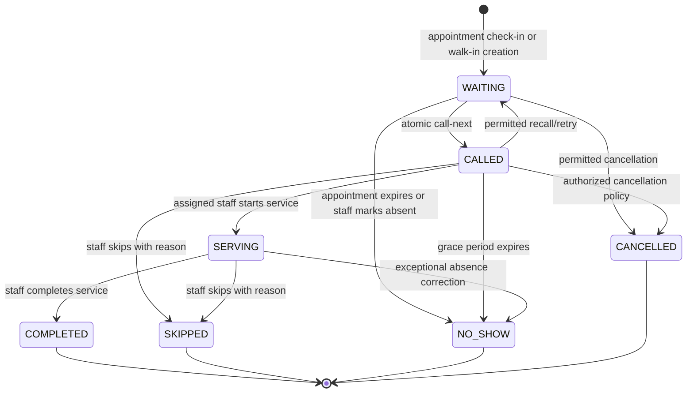

# QueueWise Queue Engine Design

**Version:** 1.0  
**Source of truth:** [PRD.md](PRD.md), [TRD.md](TRD.md), and [DATABASE_DESIGN.md](DATABASE_DESIGN.md)

## 1. Purpose

The queue engine selects the next token for a compatible counter while handling scheduled appointments, walk-ins, normal and urgent priority, multiple counters, cancellations, no-shows, paused counters, and starvation prevention.

The engine is a Spring application service backed by PostgreSQL. It is not a UI algorithm and is not implemented as a process-local Java `PriorityQueue`; process-local ordering would be lost on restart and would be unsafe when two staff members request work concurrently.

### Supported queue capabilities

- Scheduled appointments and walk-ins.
- Normal priority and urgent priority.
- Multiple counters with explicit counter-service compatibility.
- No-shows, cancellations, and paused counters.
- Queue starvation prevention for normal customers.

## 2. Token Input Model

Every token considered by the engine has these fields:

| Field | Meaning |
|---|---|
| `id` | UUID tie-breaker and database identity |
| `priority` | `NORMAL` or `URGENT` |
| `appointmentTime` | Scheduled start for an appointment; null for a walk-in |
| `creationTime` | Time the token was created |
| `readyAt` | Time the token became eligible to wait, normally check-in/arrival time |
| `status` | `WAITING`, `CALLED`, `SERVING`, `COMPLETED`, `SKIPPED`, `NO_SHOW`, or `CANCELLED` |
| `serviceId` | Service requested by the customer |
| `queueId` | Service/business-date queue |
| `eligibleCounterIds` | Counters configured to serve the token's service |
| `source` | `APPOINTMENT` or `WALK_IN` |
| `appointmentState` | For appointments, whether it is checked in, late, cancelled, or expired |
| `version` | Optimistic concurrency version |

The database remains authoritative. `eligibleCounterIds` is derived from `counter_services` and staff/counter scope; it is not a duplicated mutable list on the token.

## 3. Eligibility Rules

A token is eligible for counter `C` only when all conditions hold:

1. Token status is `WAITING`.
2. Token belongs to the requested queue/service and organization.
3. The queue is open.
4. Counter `C` is active, not paused, and supports the token's service.
5. The staff member owns or is assigned to counter `C`.
6. A walk-in has a valid `readyAt`.
7. An appointment is checked in or otherwise digitally marked present. A booked appointment that has not arrived is not called early.
8. The appointment is within its configured arrival/appointment window and is not cancelled, expired, or already no-show.
9. The token is not already assigned to another active counter.
10. The counter has no active `CALLED` or `SERVING` token unless an authorized recovery policy applies.

Cancellations and no-shows are removed by status filtering. They remain in history and never re-enter the active candidate set.

## 4. Fair Scheduling Strategy

A pure priority queue is unsafe because an endless stream of urgent arrivals can starve normal customers. QueueWise uses a starvation guard plus an aging score.

### 4.1 Configured values

The first implementation uses service-level settings with safe defaults:

```text
NORMAL_STARVATION_THRESHOLD = max(15 minutes, 2 x estimated service duration)
URGENT_BASE_SCORE = 100
NORMAL_BASE_SCORE = 0
AGING_RATE = 1 score point per waiting minute
APPOINTMENT_BONUS = 20 for an on-time checked-in appointment
MAX_CLOCK_SKEW = small server-side clock allowance
```

These values are configuration, not magic values embedded in controller code. A supervisor/admin may configure bounded values, and changes are audited.

### 4.2 Ready time and waiting age

- A walk-in's `readyAt` is its accepted arrival/creation time.
- A checked-in appointment's `readyAt` is its check-in time.
- A booked but not checked-in appointment is not eligible.
- `waitingMinutes = floor((now - readyAt) / 60 seconds)`.
- Waiting age is capped for score calculation at a configured maximum, but the starvation guard uses the real elapsed wait.

The scheduled appointment time affects eligibility and appointment preference. It does not allow the system to call a customer who has not arrived.

### 4.3 Effective score

For eligible tokens that are not protected by the starvation guard:

```text
baseScore = 100 for URGENT, otherwise 0
agingScore = min(waitingMinutes * AGING_RATE, 100)
appointmentBonus = 20 when an on-time checked-in appointment is within its window,
                   otherwise 0
lateAdjustment = -20 for a late appointment when the configured late policy applies

score = baseScore + agingScore + appointmentBonus + lateAdjustment
```

The score is used only after eligibility and starvation protection. It is not the sole fairness rule.

### 4.4 Starvation guard

A normal token is **protected** when:

```text
now - readyAt >= NORMAL_STARVATION_THRESHOLD
```

Selection rules:

1. Build the eligible candidate set for the selected counter.
2. If one or more protected normal tokens exist, select from protected normal tokens only. Choose the highest score, then earliest `readyAt`, then earliest `appointmentTime` when present, then smallest UUID.
3. Otherwise, if urgent tokens exist, select the highest-scoring urgent token.
4. Otherwise, select the highest-scoring normal token.
5. In every step, use `readyAt`, appointment preference, and UUID as deterministic tie-breakers.

This gives urgent tokens preference during normal operation but gives normal customers a bounded maximum waiting time, assuming a compatible counter continues to call work. A normal token cannot be permanently bypassed by new urgent arrivals.

A configurable emergency override may exist only for a documented operational emergency. It requires supervisor/admin permission, a reason, and an audit event; it is not the default algorithm.

## 5. Exact Next-Token Algorithm

`QueueEngine.callNext(counterId, staffUserId)` runs in one database transaction. The following is the queue-selection pseudocode.

```text
function callNext(counterId, staffUserId, now):
    counter = lock counter row by counterId

    require counter.organization is active
    require counter.status is AVAILABLE or IN_USE-without-active-token
    require staffUserId is assigned to counter
    require counter is not PAUSED
    require counter has no active CALLED or SERVING token

    queueIds = find open queues for services supported by counter
    candidates = find tokens where:
        status = WAITING
        queue_id in queueIds
        organization_id = counter.organization_id
        token.service_id is compatible with counter
        appointment is checked in or token is WALK_IN
        appointment is within its allowed window
        token is not cancelled, expired, or no-show
        token has no assigned active counter

    for each candidate:
        candidate.waitingMinutes = floor((now - candidate.readyAt) / 60 seconds)
        candidate.protectedNormal =
            candidate.priority == NORMAL and
            now - candidate.readyAt >= max(15 minutes, 2 * service.duration)
        candidate.score = calculateScore(candidate, now)

    protectedNormals = candidates where protectedNormal
    urgents = candidates where priority == URGENT

    if protectedNormals is not empty:
        selected = maxBy(protectedNormals, fairTieBreakers)
    else if urgents is not empty:
        selected = maxBy(urgents, fairTieBreakers)
    else:
        selected = maxBy(candidates, fairTieBreakers)

    if selected is absent:
        return NoEligibleToken(reason derived from counter/queue state)

    lock selected token row
    re-read selected token, counter, appointment, and compatibility
    if any eligibility rule changed:
        retry selection a bounded number of times

    update selected token:
        status = CALLED
        assigned_counter_id = counterId
        called_at = now
        version = version + 1

    update counter state if needed:
        status = IN_USE
        version = version + 1

    insert token event TOKEN_CALLED
    insert audit event QUEUE_TOKEN_CALLED

    commit transaction
    publish QueueUpdate after commit
    return selected token
```

`maxBy` compares, in order:

1. Higher score.
2. Earlier `readyAt`.
3. On-time appointment before a walk-in when scores are equal.
4. Earlier appointment time when both are appointments.
5. Smaller token UUID for deterministic final ordering.

The actual SQL should use a narrow indexed candidate query and apply the policy in a query projection or a bounded application-side candidate list. It must never load an unbounded organization's entire history.

## 6. Multiple Counters and Compatibility

Each call is scoped to one selected counter. The candidate query joins `counter_services` so only compatible service tokens are considered. Two counters supporting the same service may select different tokens concurrently. Two counters supporting different services may operate independently.

A paused counter is never eligible for `callNext`. Tokens remain in the service queue and may be selected by another compatible active counter. A counter with a `CALLED` or `SERVING` token cannot call another token.

## 7. No-Shows and Cancellations

- A customer or authorized staff member can cancel a waiting token according to service policy. The token changes to `CANCELLED`, is removed from candidate queries, and remains in history.
- A called customer who does not respond can be marked `NO_SHOW` by authorized staff/supervisor after the configured grace period. It is removed from active work and its counter is released.
- A booked appointment that never checks in can become appointment `NO_SHOW` and token `NO_SHOW` through a scheduled policy job or staff action.
- A cancelled or no-show appointment cannot later be called without an explicit, audited correction workflow.

## 8. Concurrency and Race Conditions

### Two staff members request next simultaneously

Both requests enter transactions. Each locks its selected counter row. If they use different counters, both may proceed, but PostgreSQL row locking and token claiming ensure they cannot claim the same token. If they use the same counter, the second transaction waits, then observes that the counter has an active token and returns `409 INVALID_STATE` or a no-eligible result.

The selected token is locked and rechecked before update. A stale candidate cannot be called after cancellation, another counter's assignment, pause, or completion.

### Race scenarios

| Race | Protection |
|---|---|
| Two counters select same token | Token row lock, assigned-counter check, version/unique active assignment rule |
| Call occurs while cancellation commits | Transaction lock and state recheck; one transition wins |
| Counter pauses during selection | Counter lock and recheck before token update |
| Appointment expires during selection | Appointment/token lock and window recheck |
| Two walk-ins request a number | Queue row lock or scoped sequence plus unique constraint |
| Staff retries after timeout | Idempotency key or current-state response; no duplicate transition |

A bounded retry is appropriate for serialization/deadlock errors. Do not retry indefinitely or hide a persistent conflict.

## 9. Complexity Analysis

### Time complexity and space complexity

Let `n` be the number of eligible waiting tokens returned for a counter and `c` the number of compatible services/counters.

- Candidate lookup: approximately `O(log N + n)` with indexes, where `N` is the relevant token index size.
- In-memory policy selection: `O(n)` using a scan, or `O(n log n)` if sorting the full candidate list. The recommended implementation uses one scan with best-candidate tracking.
- Space: `O(n)` for a bounded candidate page; target a configured maximum such as 100 or 500 candidates. If the query requires pagination, continue scanning in deterministic order without loading the entire organization.
- Locking: row-level locks on one counter, the selected token, and the queue/version row required for numbering or scheduling state.

The engine must be measured with realistic queue sizes. Correctness and fairness take precedence over a micro-optimized but opaque ordering expression.

## 10. Fairness and Starvation Analysis

### Normal customers

A normal token becomes protected after the starvation threshold and is selected before newer unprotected urgent work. Therefore, continuous urgent arrivals cannot indefinitely bypass it. The practical maximum also depends on compatible counter availability, pauses, service closure, and staff action; these conditions are surfaced rather than hidden.

### Urgent customers

Urgent tokens receive a large base score and are selected before normal tokens during ordinary operation. A very old normal token can temporarily take precedence by design. This is the fair tradeoff: urgency receives preference, not unlimited service monopoly.

### Appointments versus walk-ins

A checked-in on-time appointment gets a small preference bonus, but a walk-in that has waited beyond the normal threshold is protected. A future appointment is not called merely because its scheduled time exists; the customer must be present or digitally checked in.

### Paused counters

A paused counter reduces capacity but does not change token order. The UI and analytics must make the capacity reduction visible so an apparent wait increase is explainable.

## 11. Token State Model

Queue selection only moves `WAITING` to `CALLED`. Service operations handle later transitions:



Terminal states are `COMPLETED`, `SKIPPED`, `NO_SHOW`, and `CANCELLED`. A correction workflow, if later required, must create a new audited event and must not silently rewrite history.

## 12. Queue Engine Classes

- `QueueEngine`: transaction boundary and orchestration for `callNext`.
- `EligibilityPolicy`: pure checks for status, arrival, appointment window, service, counter, and scope.
- `PriorityPolicy`: normal/urgent base score and appointment bonus.
- `FairnessPolicy`: starvation threshold and protected-normal decision.
- `CandidateScore`: immutable calculated score and tie-break fields.
- `WaitEstimateService`: calculates approximate customer wait from eligible work and duration estimates.
- `QueueRepository`: indexed candidate query and queue state access.
- `TokenStateTransitionService`: validates and persists state changes.
- `QueueUpdatePublisher`: publishes committed WebSocket updates.
- `AuditService`: records actor, token, counter, reason, and result.

Policy classes should be unit-testable without Spring or PostgreSQL. `QueueEngine` and repository locking behavior require integration tests.

## 13. Test Cases

### Eligibility and ordering

1. Empty queue returns no eligible token.
2. One normal walk-in is selected.
3. One urgent and one normal token selects urgent when normal is below threshold.
4. A normal token beyond the starvation threshold is selected before a newly arrived urgent token.
5. Two urgent tokens select higher score, then earlier `readyAt`, then UUID tie-break.
6. On-time checked-in appointment beats an equal-score walk-in.
7. Future, not-checked-in appointment is not selected.
8. Late appointment follows configured late policy.
9. Token for incompatible service is not selected.
10. Token is not selected for a paused counter.
11. Cancelled and no-show tokens are excluded.
12. Token assigned to another active counter is excluded.

### Lifecycle and operations

13. `WAITING -> CALLED` records called time, counter, token event, audit event, and WebSocket update.
14. Staff can start only a token called for their selected counter.
15. Completion records service duration and removes the token from the queue.
16. Skip requires a reason and is terminal.
17. No-show after grace period releases the counter.
18. Cancellation before call removes the token from active position.

### Concurrency

19. Two calls on the same counter result in one success and one conflict/current-state response.
20. Two compatible counters never receive the same token.
21. Call and cancellation racing on one token produce one valid transition.
22. Pause racing with call cannot result in a new call after pause commits.
23. Retrying the same request does not create a second token event or assignment when idempotency is supported.
24. Serialization/deadlock retry is bounded and eventually returns a safe conflict.

### Fairness properties

25. Repeated urgent arrivals cannot keep a normal token waiting past the configured threshold while an active compatible counter is calling tokens.
26. Aging increases a normal token's score over time.
27. A paused compatible counter is reflected in capacity and does not reorder tokens.
28. Deterministic inputs produce the same selected token after application restart.

## 14. Operational Metrics

Record and monitor:

- Candidate query duration.
- Time from `readyAt` to `CALLED` by source and priority.
- Count of protected-normal selections.
- Count of queue conflicts and bounded retries.
- Tokens skipped, no-show, cancelled, and completed.
- Active counters versus paused counters.
- WebSocket update latency after commit.

These metrics validate that the fairness policy is doing useful work rather than merely existing in code.
