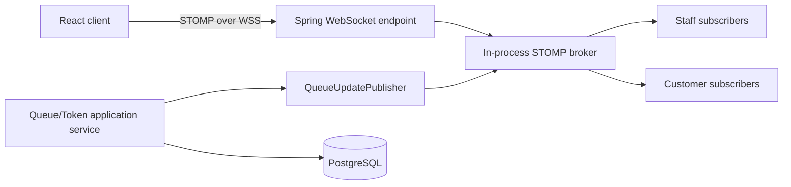

# QueueWise Real-Time Queue Update Design

**Version:** 1.0  
**Source of truth:** [TRD.md](TRD.md), [QUEUE_ENGINE.md](QUEUE_ENGINE.md), and [AUTHENTICATION.md](AUTHENTICATION.md)  
**Technology:** Spring WebSocket, STOMP, React client

## 1. Purpose

QueueWise uses real-time updates to show customers and staff when queue state changes. The database and REST API remain authoritative. WebSocket messages are notifications that allow clients to refresh quickly; no business decision depends only on a browser message.

The system sends updates when:

- A token is called.
- A token starts serving.
- A token is completed.
- A token is skipped.
- Queue position or estimated wait changes.
- A counter is paused.
- A counter resumes.

## 2. Why WebSocket

Queue state changes are event-driven and users benefit from seeing them quickly. WebSocket avoids repeated requests from every browser when no change has occurred and gives staff and customers a responsive queue display.

Polling is sufficient when:

- The screen is informational and a delay of 15 to 60 seconds is acceptable.
- The client is inactive or in the background.
- The browser cannot maintain a WebSocket connection.
- The deployment has very few updates and simplicity matters more than latency.

For QueueWise's staff counter and customer token screens, WebSocket plus REST fallback is appropriate. It is not a reason to introduce Kafka, Redis, or a separate real-time service.

## 3. Components



- `WebSocketConfig`: registers the endpoint, STOMP broker, message prefixes, and handshake rules.
- `WebSocketAuthenticationInterceptor`: validates the JWT from the STOMP CONNECT frame.
- `WebSocketAuthorizationService`: verifies organization/service/counter/token subscription scope.
- `QueueUpdatePublisher`: maps committed domain events to update messages.
- `QueueUpdateMessage`: stable, small message DTO for clients.
- `ConnectionRegistry` or broker session callbacks: tracks connect/disconnect metadata for metrics, not business truth.

## 4. WebSocket Endpoint

Use one endpoint:

```text
/ws
```

Production clients use `wss://api.example.com/ws`; local clients use the configured development URL. The endpoint accepts a WebSocket upgrade and STOMP frames. SockJS may be enabled only if browser/proxy compatibility requires it; it is not necessary by default.

STOMP configuration:

```text
Application destination prefix: /app
Broker destination prefixes: /topic, /user
User destination prefix: /user
```

Client commands are intentionally limited. Queue commands such as call-next, start, complete, pause, and resume remain REST commands so their authorization, idempotency, and HTTP error handling are explicit. WebSocket is primarily for server-to-client updates.

## 5. Topics and Subscriptions

### Organization/service queue

```text
/topic/organizations/{organizationId}/queues/{serviceId}
```

Used by authorized staff, supervisors, receptionists, and customers who are permitted to view that service queue. Customer views should receive a privacy-safe projection rather than all customer details.

### Counter

```text
/topic/counters/{counterId}
```

Used by staff assigned to the counter and supervisors/admins in scope. Contains current token, counter state, and next-work updates.

### Customer token

```text
/user/queue/token-updates
```

A user-specific destination for the authenticated customer's own token status, called/start/completed notifications, and relevant wait changes.

### Admin operational updates

The MVP does not need a broad organization-wide admin topic. Admin screens can use REST analytics and scoped service topics. Add an admin topic only for a demonstrated operational need.

## 6. Subscription Authorization

Authorization occurs at the STOMP CONNECT and SUBSCRIBE stages:

1. Validate the bearer JWT and build the authenticated principal.
2. Confirm the user is active and belongs to the organization in the destination.
3. For a service topic, verify customer ownership/view policy or staff/supervisor/admin service scope.
4. For a counter topic, verify staff assignment or supervisor/admin scope.
5. For a user destination, allow only the authenticated user's own destination.
6. Reject unauthorized subscriptions with an error frame and do not reveal whether another organization's resource exists.

A destination string is untrusted input. Do not authorize only by parsing a frontend-supplied organization or counter ID. Re-check active scope for sensitive subscriptions and keep messages privacy-safe.

JWT validation uses the same issuer, audience, signature, and expiry rules as REST. WebSocket authentication does not make a user authorized to execute REST commands.

## 7. Message Format

All messages have a stable envelope:

```json
{
  "eventId": "uuid",
  "eventType": "TOKEN_CALLED",
  "organizationId": "uuid",
  "queueId": "uuid",
  "serviceId": "uuid",
  "tokenId": "uuid",
  "counterId": "uuid",
  "status": "CALLED",
  "queuePosition": null,
  "estimatedWaitSeconds": 0,
  "version": 12,
  "occurredAt": "2026-09-17T10:15:30Z"
}
```

Fields may be null when not relevant. Do not send customer email, phone, password, JWT, internal exception, or unnecessary personal details to a shared topic.

Event types:

| Event | Trigger |
|---|---|
| `TOKEN_CALLED` | Waiting token atomically assigned to a counter |
| `SERVICE_STARTED` | Staff starts the called token |
| `SERVICE_COMPLETED` | Staff completes the serving token |
| `TOKEN_SKIPPED` | Staff skips a token with a reason |
| `TOKEN_NO_SHOW` | Staff/system marks absence |
| `TOKEN_CANCELLED` | Customer/staff cancellation succeeds |
| `QUEUE_POSITION_CHANGED` | Position or estimate changes materially |
| `COUNTER_PAUSED` | Counter pause commits |
| `COUNTER_RESUMED` | Counter resume commits |
| `QUEUE_CHANGED` | General queue membership or capacity change |

`version` is the token or queue aggregate version. Clients can ignore an older message than the version already rendered.

## 8. Publication Timing

Business commands run in a PostgreSQL transaction. The application:

1. Locks and validates the aggregate.
2. Updates token, counter, appointment, event, and audit records.
3. Commits the transaction.
4. Publishes the real-time message after commit.

Publishing before commit can show a state that later rolls back. Publishing after commit means a process crash can lose the notification, so clients must refetch after reconnect and important screens may periodically reconcile. A database-backed outbox can be added later if measured delivery guarantees require it; it is not necessary for the first modular-monolith implementation.

## 9. Queue Position Updates

The server calculates queue position using the same eligibility and fair scheduling rules as `QueueEngine`. After a token is created, called, completed, skipped, cancelled, a counter is paused/resumed, or a relevant appointment becomes ready, publish a `QUEUE_CHANGED` or `QUEUE_POSITION_CHANGED` update.

The client must not calculate authoritative position from message arrival order. It may display the last message immediately, then fetch `GET /queues` or `GET /tokens/{id}` for authoritative position and estimate.

Avoid publishing one message per unaffected token for large queues. Publish a queue version and affected token IDs; customers can refetch their own token state. Staff queue views may refetch the scoped queue after a change.

## 10. Reconnect Behavior

The frontend WebSocket hook should:

1. Connect after an authenticated session is available.
2. Subscribe only after the STOMP CONNECTED frame.
3. Use bounded exponential backoff with jitter, for example 1, 2, 4, 8, then 30 seconds.
4. Stop or slow reconnecting when the browser is offline or the page is hidden.
5. On reconnect, refetch current user, token, counter, and queue queries before trusting new updates.
6. Resubscribe after a successful connection.
7. Show a non-blocking stale/offline indicator for staff and customers.

Do not queue mutating queue commands in the browser during a disconnected period. Commands use REST and are retried only when their idempotency policy permits.

## 11. Stale Connections and Heartbeats

Configure STOMP heartbeats for client-to-server and server-to-client liveness. The broker should close connections that miss the negotiated heartbeat within a bounded timeout. The server tracks session connect/disconnect and last heartbeat for observability, not queue correctness.

A stale connection must not reserve a counter or token. Counter ownership is stored in PostgreSQL with a timeout/release policy and explicit release; WebSocket disconnect alone is not a reliable business event.

Messages include `occurredAt` and version. A client ignores an older version and refetches if it detects a gap or receives an event for an unknown version.

## 12. Frontend State Synchronization

React Query remains the source of frontend server state:

- `useQueueUpdates` subscribes to the applicable topics.
- On `TOKEN_CALLED`, update/invalidate the customer's token query and invalidate the queue query for staff.
- On `SERVICE_STARTED` or `SERVICE_COMPLETED`, invalidate the token and queue queries.
- On `TOKEN_SKIPPED` or `TOKEN_CANCELLED`, invalidate queue and history queries.
- On `QUEUE_POSITION_CHANGED`, update only the affected token when the payload is complete, then reconcile through REST.
- On `COUNTER_PAUSED`/`COUNTER_RESUMED`, invalidate counter and queue queries.

Optimistic updates are discouraged for lifecycle commands because a command may lose a concurrency race. Show a pending state while the REST command completes, then render the server response.

## 13. Error Handling

- Invalid STOMP CONNECT authentication: close/reject connection with safe authentication error.
- Unauthorized SUBSCRIBE: reject subscription without resource disclosure.
- Malformed message: reject the frame and record a safe protocol error.
- Server publish failure: log with correlation/event ID and rely on reconnect/refetch; do not roll back committed business state.
- Client receives unknown event type: ignore safely and refetch the relevant resource if possible.
- Expired JWT during a connection: stop receiving protected updates, refresh/relogin according to authentication policy, and reconnect.

## 14. Scaling Boundary

The in-process STOMP broker is appropriate for one backend instance. If the modular monolith later runs multiple backend instances, every instance must receive the same committed queue events. That requires a deliberate shared broker or database-backed outbox strategy and session-routing design.

Do not add Redis or Kafka only because WebSocket exists. First measure active connections, event rate, message latency, and missed-event frequency. PostgreSQL and one application instance are the MVP design.

## 15. Testing

1. Valid JWT can connect and subscribe to an authorized service topic.
2. Invalid/expired JWT cannot connect or subscribe.
3. Customer cannot subscribe to another customer's token destination.
4. Staff cannot subscribe to an unassigned counter.
5. Authorized customer receives `TOKEN_CALLED`.
6. Staff receives start, complete, skip, pause, and resume updates.
7. Queue position update is emitted after cancellation and completion.
8. Message contains version and timestamp and excludes sensitive fields.
9. Transaction rollback produces no success message.
10. Reconnect refetches REST state and resubscribes.
11. Older message versions do not overwrite newer React Query state.
12. Missed message during disconnect is corrected by refetch.
13. Heartbeat timeout closes a stale connection.
14. REST remains usable when WebSocket is unavailable.
15. Multiple subscriptions do not grant cross-organization access.

## 16. When to Prefer Polling

Use polling for low-value or low-frequency data such as admin health summaries, historical analytics, or a customer screen that accepts a visible 30-second delay. Use WebSocket for active staff queues and near-turn customer state. Both paths should call the same authorized REST read model so correctness is consistent.
