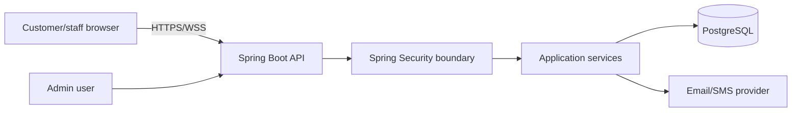

# QueueWise Security Design

**Version:** 1.0  
**Source of truth:** [PRD.md](PRD.md), [TRD.md](TRD.md), [AUTHENTICATION.md](AUTHENTICATION.md), and [API_SPECIFICATION.md](API_SPECIFICATION.md)  
**Security model:** Spring Security, JWT, PostgreSQL, validated DTOs, scoped authorization

## 1. Security Objectives

QueueWise must protect customer identity, appointments, tokens, staff operations, configuration, audit records, and credentials while remaining understandable for a student production-style project.

The design uses:

- Spring Security's stateless request pipeline.
- BCrypt or an approved adaptive password encoder.
- Short-lived signed JWT access tokens.
- PostgreSQL organization/resource scoping.
- DTO validation and centralized safe errors.
- Database constraints and transactions for integrity.
- Append-only audit records for important actions.
- No OAuth2 provider, microservices, Redis, Kafka, or file storage in the MVP.

## 2. Trust Boundaries

- Browser input, headers, JWTs, query parameters, STOMP destinations, and IDs are untrusted.
- The backend is the enforcement point; hidden frontend controls are not security.
- PostgreSQL is trusted for constraints but not for authorization decisions by itself.
- Notification providers are external dependencies and must receive only required data.
- Secrets are trusted only when injected by the deployment environment.

## 3. Threat and Control Matrix

Each threat below has an attack scenario, impact, mitigation, implementation location, and test case.

### 3.1 Authentication

**Attack scenario:** An attacker submits guessed, stolen, malformed, expired, or forged credentials/tokens to access QueueWise.

**Impact:** Account takeover, unauthorized customer data access, staff queue manipulation, or admin compromise.

**Mitigation:** Use `DaoAuthenticationProvider`, adaptive password hashing, signed short-lived JWTs, issuer/audience/expiry/signature validation, active-account checks, generic credential errors, HTTPS, login throttling, and no default credentials. Never trust a client-provided user ID or role.

**Implementation location:** `security/SecurityConfig`, `JwtAuthenticationFilter`, `JwtTokenService`, `QueueWiseUserDetailsService`, `authentication/AuthService`, `AuthenticationController`, database `users` status.

**Test case:** Login with valid credentials succeeds; wrong password, unknown account, inactive account, malformed JWT, wrong signature, wrong issuer, and expired JWT all fail safely without exposing which credential detail was wrong.

### 3.2 Authorization

**Attack scenario:** An authenticated customer calls a staff/admin endpoint, or staff calls a token operation outside their service/counter scope.

**Impact:** Unauthorized configuration changes, queue manipulation, or disclosure of other customers' records.

**Mitigation:** Apply role checks with method security and resource checks in application services. Every request verifies organization scope, ownership, assignment, counter compatibility, and current lifecycle state.

**Implementation location:** `@PreAuthorize` on application services/controllers, `OrganizationAuthorizationService`, `CurrentUser`, service-layer authorization, repository queries with organization predicates.

**Test case:** Customer receives `403` for admin endpoints; staff cannot process an unassigned counter; supervisor outside a service scope is denied; admin emergency action requires a reason and audit record.

### 3.3 Password Storage

**Attack scenario:** An attacker reads the database or application logs and attempts to recover passwords.

**Impact:** Password reuse compromise across QueueWise and other services.

**Mitigation:** Store only BCrypt/Argon2 adaptive hashes. Use `PasswordEncoder.matches`; never decrypt or compare plaintext in SQL. Redact password fields from DTOs, logs, audit JSON, exception messages, and test snapshots.

**Implementation location:** `PasswordEncoder` bean in `SecurityConfig`, registration service, login provider, user migration, logging redaction.

**Test case:** Database value is not equal to the submitted password; registration response and logs contain no password or hash; only the original password matches.

### 3.4 JWT Security

**Attack scenario:** An attacker modifies role/org claims, uses a token signed with an unexpected algorithm, replays a stolen token, or submits a token issued for another audience.

**Impact:** Privilege escalation or unauthorized API access.

**Mitigation:** Allow-list the signing algorithm; validate signature, issuer, audience, subject, `iat`, `nbf`, and `exp`; use a short access-token lifetime; keep claims small; never accept algorithm choice from the token; re-check active user and resource scope for sensitive operations. Rotate signing keys with a key ID plan.

**Implementation location:** `JwtTokenService`, `JwtAuthenticationFilter`, environment secret configuration, security integration tests.

**Test case:** Modified claims, `alg=none`, wrong key, wrong issuer, wrong audience, expired token, and malformed token are rejected with `401`.

### 3.5 CORS

**Attack scenario:** A malicious website attempts browser calls to the API or a permissive wildcard configuration allows unintended origins with credentials.

**Impact:** Cross-origin data exposure or abuse of cookie-based refresh flow.

**Mitigation:** Configure an explicit origin allowlist per environment, restrict methods and headers, never combine wildcard origin with credentials, and treat CORS as a browser control rather than authorization.

**Implementation location:** `CorsConfigurationSource`, `SecurityConfig`, environment variable `CORS_ALLOWED_ORIGINS`, deployment configuration.

**Test case:** Configured frontend origin succeeds; unknown origin is rejected; wildcard credentials configuration is impossible in production configuration validation.

### 3.6 Input Validation

**Attack scenario:** An attacker submits malformed UUIDs, invalid dates, huge page sizes, unexpected enum values, oversized text, or values that violate business rules.

**Impact:** Data corruption, denial of service, unexpected exceptions, or bypass of queue/appointment policies.

**Mitigation:** Use Jakarta Bean Validation on request DTOs, bounded strings and collections, strict enums, service-layer business validation, date/time-zone validation, and database constraints. Reject unknown/oversized input and return safe field errors.

**Implementation location:** Request DTO annotations, controller validation, application services, database check constraints, global `@RestControllerAdvice`.

**Test case:** Invalid UUID/date/status, negative duration, oversized text, unknown fields, page size above 100, and invalid service configuration return `400` with no database mutation.

### 3.7 SQL Injection

**Attack scenario:** An attacker places SQL syntax in search, sort, filter, or identifier input.

**Impact:** Unauthorized reads, data modification, or database compromise.

**Mitigation:** Use Spring Data parameters, JPQL parameters, or parameterized native SQL. Never concatenate user input into SQL. Allow-list sort fields and map them to known columns. Limit database account privileges and avoid exposing SQL errors.

**Implementation location:** Repository queries, `AnalyticsRepository`, search/filter mappers, database user configuration, global error handler.

**Test case:** Service/customer/audit search containing quotes, comments, unions, and SQL operators returns a normal validation/no-result response and cannot access unrelated tables.

### 3.8 XSS

**Attack scenario:** A user enters script markup in service instructions, names, notes, or notification content and another user's browser renders it as HTML.

**Impact:** Session theft, malicious actions, or customer/staff phishing inside the application.

**Mitigation:** React escapes text by default; do not use `dangerouslySetInnerHTML` for user content. Validate length/content type server-side, encode output in any non-React response, sanitize only if rich text is later explicitly required, and use a restrictive Content Security Policy where deployment permits.

**Implementation location:** React components, DTO validation, service instruction renderer, HTTP security headers, notification template handling.

**Test case:** Store `<script>` and event-handler payloads in every text field; browser renders them as text or rejects them and no script executes.

### 3.9 CSRF

**Attack scenario:** A malicious site causes a browser to submit a state-changing request using automatically attached cookies.

**Impact:** Unauthorized cancellation, counter pause, configuration change, or account action.

**Mitigation:** MVP bearer access tokens are not automatically attached by the browser, so CSRF protection can be disabled for those API routes with the decision documented. If refresh/authentication cookies are introduced, use Secure, HttpOnly, SameSite cookies plus a CSRF token strategy for cookie-authenticated commands. Do not treat CORS as CSRF protection.

**Implementation location:** `SecurityConfig`, refresh-token controller, cookie configuration, frontend Axios configuration.

**Test case:** Cookie-authenticated state-changing request without a valid CSRF token fails; bearer-only API operation is not accidentally changed to cookie authentication without a security review.

### 3.10 Rate Limiting

**Attack scenario:** An attacker floods login, registration, appointment booking, token creation, analytics export, or WebSocket handshake endpoints.

**Impact:** Credential guessing, resource exhaustion, duplicate business commands, or degraded service.

**Mitigation:** Apply endpoint-specific limits by IP, account, organization, and authenticated user. Use bounded page/export ranges, idempotency keys for booking/commands, login backoff, and deployment/reverse-proxy coarse limits. Do not add a distributed rate-limit store before measuring need.

**Implementation location:** Authentication service, servlet filter or gateway boundary if available, controller command idempotency, deployment configuration, metrics.

**Test case:** Repeated login/booking/export requests return `429` with `Retry-After` where applicable; valid requests resume after cooldown; rate limiting does not reveal whether an account exists.

### 3.11 IDOR

**Attack scenario:** A customer changes `/appointments/{id}` or `/tokens/{id}` to another valid UUID and retrieves or mutates another customer's record.

**Impact:** Direct exposure of appointment history, contact details, queue state, or unauthorized cancellation.

**Mitigation:** Every repository lookup includes organization scope; application services verify ownership or assigned staff scope; unknown/out-of-scope resources use safe not-found behavior. UUIDs are defense in depth, not authorization.

**Implementation location:** `AppointmentAuthorizationService`, `TokenAuthorizationService`, scoped repository methods, controllers, tests.

**Test case:** Customer A requests customer B's appointment/token and receives `404` or `403` without data; staff scope is similarly enforced.

### 3.12 Sensitive Information Exposure

**Attack scenario:** API errors, logs, analytics, WebSocket messages, backups, or DTOs expose passwords, JWTs, phone/email data, SQL, stack traces, or provider credentials.

**Impact:** Account takeover, privacy violation, regulatory exposure, or easier exploitation.

**Mitigation:** Use response DTOs, safe problem details, structured redacted logs, privacy-safe shared queue messages, secret scanning, encrypted transport, least-data analytics, and backup access controls. Never expose JPA entities directly.

**Implementation location:** DTO mappers, `RestControllerAdvice`, logging configuration, WebSocket message DTOs, audit redaction, deployment secret/backup configuration.

**Test case:** Inspect login, error, queue, analytics, audit, and notification responses/logs for forbidden fields; unexpected exception returns only a correlation ID.

### 3.13 Mass Assignment

**Attack scenario:** A client adds `role=ADMIN`, `organizationId=other-org`, `status=ACTIVE`, or `assignedCounterIds` to a customer/profile update and the binder persists it.

**Impact:** Privilege escalation, cross-organization access, or unauthorized staff assignment.

**Mitigation:** Use purpose-specific request DTOs instead of binding JSON to entities. Ignore or reject unknown fields. Set actor, organization, role, status, and assignment fields only in authorized application services. Use separate admin commands for staff management.

**Implementation location:** Request DTOs, mappers, service commands, Jackson unknown-property policy, authorization tests.

**Test case:** Customer submits admin fields and they are rejected or ignored without mutation; admin staff command permits only documented fields.

### 3.14 Broken Access Control

**Attack scenario:** A user bypasses UI routes and directly calls pause counter, assign staff, skip token, view audit, or export analytics endpoints.

**Impact:** Operational disruption, privacy breach, or administrative takeover.

**Mitigation:** Deny unlisted routes by default, enforce roles at method/service level, enforce organization/resource scope, test every protected endpoint directly with MockMvc, and audit elevated actions.

**Implementation location:** `SecurityFilterChain`, `@PreAuthorize`, application authorization services, repository scope predicates, API tests.

**Test case:** Each role is tested against each sensitive endpoint; direct HTTP calls fail even when the frontend route guard is bypassed.

### 3.15 File Uploads

**Attack scenario:** A future feature accepts an executable, oversized, malicious, or public file upload.

**Impact:** Malware storage/delivery, denial of service, path traversal, or server-side code execution.

**MVP decision:** QueueWise has no file-upload feature. Do not add multipart endpoints, file storage, or upload libraries.

**Future mitigation if required:** Store outside the application classpath, generate server-side names, enforce size/type/content scanning, avoid trusting extensions, use private object storage, authorize download per resource, and never execute uploaded content.

**Implementation location:** Current API design excludes uploads; future `FileService`, controller, storage policy, and security tests would own it.

**Test case:** Assert no multipart endpoint exists in the MVP API contract. If introduced later, test path traversal, oversized files, spoofed MIME type, malware fixture, unauthorized download, and retention cleanup.

### 3.16 WebSocket Authorization

**Attack scenario:** A customer subscribes to another organization's queue topic, a staff member subscribes to an unassigned counter, or a stale JWT remains connected after access changes.

**Impact:** Live privacy breach or operational information exposure.

**Mitigation:** Validate JWT during STOMP CONNECT; authorize every SUBSCRIBE destination by organization, service, counter, and user scope; use privacy-safe messages; expire/reconnect sessions; keep commands on REST; re-check sensitive scope and refetch state.

**Implementation location:** `WebSocketConfig`, STOMP channel interceptor, `WebSocketAuthorizationService`, `QueueUpdatePublisher`, frontend subscription hook.

**Test case:** Valid staff subscription succeeds; cross-organization, unassigned counter, customer-other-token, expired JWT, and malformed destination subscriptions fail.

### 3.17 Secret Management

**Attack scenario:** JWT keys, database passwords, provider credentials, or refresh secrets are committed to Git, printed in logs, or bundled into the React application.

**Impact:** Full application compromise or external-provider abuse.

**Mitigation:** Inject secrets through environment/deployment secret stores; fail production startup when required secrets are absent; use separate environment keys; rotate signing keys; add secret scanning; never expose backend secrets to Vite.

**Implementation location:** Spring configuration properties, Docker Compose local secret setup, GitHub Actions secrets, deployment configuration, logging redaction.

**Test case:** Repository and built frontend contain no secret; production profile fails without required secret; logs do not print resolved secret values; old JWT key rotation follows expiry window.

### 3.18 Logging

**Attack scenario:** Logs contain raw passwords, bearer tokens, personal data, SQL values, or untrusted strings that corrupt log analysis.

**Impact:** Credential/privacy leakage and unreliable incident investigation.

**Mitigation:** Structured logs with correlation IDs, allow-listed fields, token/password redaction, bounded user input, safe exception mapping, and restricted log access. Log security outcomes, not secrets.

**Implementation location:** Logback/SLF4J configuration, request logging filter, exception handler, security/auth services, deployment log retention.

**Test case:** Login, failed JWT, booking, queue transition, and provider failure logs are inspected for redaction and valid structured fields; malicious newline input is encoded safely.

### 3.19 Audit Trails

**Attack scenario:** An administrator or staff member changes priority, cancels a token, pauses a counter, changes roles, or edits service configuration and later denies the action.

**Impact:** No accountability, difficult incident response, and unreliable operational history.

**Mitigation:** Append-only `audit_logs` with actor, organization, action, entity, before/after safe summaries, reason, timestamp, correlation ID, source IP, and outcome. Audit events are persisted after the business transaction commits, metadata is allow-listed/redacted for password, JWT, authorization, and secret keys, and entity lifecycle guards reject updates/deletes. Include security, configuration, appointment, token, counter, and permission events. Restrict reads by scope and prevent ordinary update/delete.

**Implementation location:** `AuditService`, domain event listeners, transactional command services, `audit_logs` table, admin audit API.

**Test case:** Successful and failed elevated actions create expected audit records; non-admin cannot edit/delete; audit payload excludes secrets; event links to request correlation ID.

QueueWise publishes audit events from application services after the resource mutation has
The current application services emit `USER_REGISTERED`, `LOGIN`, `TOKEN_CREATED`,
`TOKEN_CALLED`, `TOKEN_COMPLETED`, `TOKEN_SKIPPED`, `COUNTER_PAUSED`, and
`COUNTER_RESUMED`. `APPOINTMENT_CREATED`, `APPOINTMENT_CANCELLED`, `SERVICE_CREATED`,
and `SERVICE_UPDATED` are reserved action codes already present in the audit contract;
been accepted. The listener persists them in an `AFTER_COMMIT` transaction, so a rolled-back
business command does not leave a false success audit row. Events carry the action timestamp,
actor, organization, resource type/id, correlation ID, and permitted source IP. Metadata is
sanitized by a deny-list for credential-shaped keys before JSONB serialization; passwords,
password hashes, JWTs, authorization headers, and secret material are never audit fields.

## 4. Database and Application Security Controls

- Use separate database credentials for application and migrations where practical.
- Grant the runtime user only required schema permissions.
- Use foreign keys, check constraints, unique indexes, and transaction isolation for integrity.
- Use parameterized queries and safe sort allowlists.
- Encrypt PostgreSQL connections in deployed environments.
- Restrict database network access to the backend.
- Back up and test restoration with access controls and encryption.
- Keep dependencies and container base images patched through CI scanning.
- Do not return entities directly from controllers.

## 5. Security Headers

At the HTTP boundary configure, as appropriate for the deployment:

- `Content-Security-Policy` appropriate to the Vite build.
- `X-Content-Type-Options: nosniff`.
- `Referrer-Policy` with limited referrer data.
- `Strict-Transport-Security` only when HTTPS is guaranteed.
- `Cache-Control: no-store` for authentication and sensitive personal responses.
- Frame protection through modern CSP `frame-ancestors`.

Headers are not a substitute for authorization or output encoding.

## 6. Security Testing Plan

### Unit tests

- Password encoding/matching.
- JWT creation and all validation failures.
- Role mapping and authorization policy.
- Appointment/token ownership checks.
- Input validators and safe sort/filter mapping.
- Audit redaction.

### Spring Boot and MockMvc tests

- Public versus protected route rules.
- Every role against every admin/staff/customer endpoint.
- IDOR and cross-organization access.
- Validation and mass-assignment payloads.
- Safe error response and absence of stack traces.
- CORS, CSRF decision, rate limit behavior, and security headers.

### Integration tests

- PostgreSQL constraints and transaction rollback.
- Concurrent appointment booking and token assignment.
- Audit records written with successful commands.
- WebSocket CONNECT/SUBSCRIBE authorization.
- Notification provider failure without state rollback.

### Operational checks

- Dependency and container image scans.
- Secret scanning in GitHub Actions.
- Backup restore exercise.
- Log and audit access review.
- Review of JWT key rotation and environment configuration.

## 7. Security Acceptance Criteria

1. No plaintext password, JWT, private key, or provider secret is stored or logged.
2. Every protected REST and WebSocket resource enforces role and organization/resource scope.
3. Invalid JWTs, expired JWTs, and wrong-role requests receive safe `401`/`403` responses.
4. Customer and staff IDOR tests fail safely.
5. SQL injection, XSS, CSRF, validation, mass-assignment, and rate-limit tests pass.
6. Token, appointment, counter, role, and configuration changes are auditable.
7. No file-upload surface exists in the MVP.
8. Security controls do not rely solely on frontend route guards.
9. Production secrets are externalized and missing required secrets prevent unsafe startup.
10. Security failures do not expose internal exception messages or database details.
