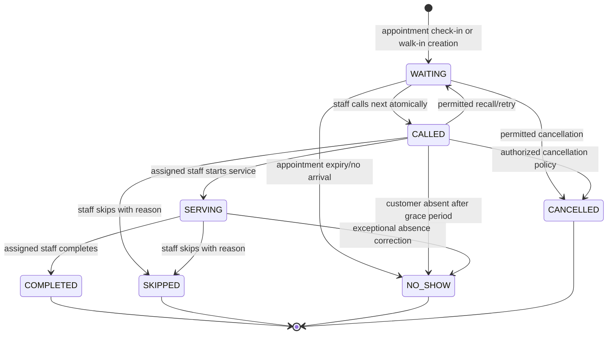

# QueueWise Token Lifecycle

**Version:** 1.0  
**Source of truth:** [PRD.md](PRD.md), [QUEUE_ENGINE.md](QUEUE_ENGINE.md), and [DATABASE_DESIGN.md](DATABASE_DESIGN.md)

## 1. Lifecycle States

| State | Meaning | Terminal? |
|---|---|---:|
| `WAITING` | Token is eligible or waiting for its appointment/arrival rules. | No |
| `CALLED` | A specific compatible counter has called the customer. | No |
| `SERVING` | Staff has started service at the assigned counter. | No |
| `COMPLETED` | Service ended successfully. | Yes |
| `SKIPPED` | Staff skipped the token with a required reason. | Yes |
| `NO_SHOW` | Customer did not appear or respond within policy. | Yes |
| `CANCELLED` | Customer or authorized staff cancelled the token. | Yes |

A token is created as `WAITING` only after an appointment check-in/arrival policy or walk-in creation succeeds. A booked appointment that has not arrived is not an active waiting token for `callNext`.

## 2. State Transition Diagram



The `CALLED -> WAITING` retry is intentionally restricted. It is for a configured recall policy, not a general way to move a token backward. `SERVING -> NO_SHOW` is an exceptional supervisor/admin correction and should be disabled unless the organization explicitly needs it.

## 3. Transition Contract

Every transition is a command with an actor, current state, target state, reason where required, token version, and correlation ID. The backend performs the transition inside a transaction and appends a `token_events` row.

### 3.1 Create -> `WAITING`

- **Who:** Customer appointment check-in, receptionist walk-in creation, authorized staff/admin according to policy, or system appointment-arrival job.
- **Conditions:** Service is active/open; customer and organization are valid; appointment is bookable/checked in or walk-in is authorized; token reference is unique; no duplicate appointment token exists; priority is permitted.
- **Database changes:** Insert `tokens` row with `status = WAITING`, source, priority, queue, service, customer, `ready_at`, and version 0. For an appointment, set unique `appointment_id`. Insert `token_events` with `TOKEN_CREATED` and optionally `APPOINTMENT_CHECKED_IN`. Create notification request after commit.
- **WebSocket event:** `TOKEN_CREATED` and `QUEUE_CHANGED` to authorized queue subscribers; own-token update to the customer.
- **Audit event:** `TOKEN_CREATED` with actor, source, priority, service, and queue.
- **Possible errors:** `400` invalid request; `403` unauthorized walk-in/urgent priority; `404` service/customer/queue missing; `409` duplicate appointment token or token-number race; `422` service closed, appointment not eligible, or capacity unavailable.

### 3.2 `WAITING -> CALLED`

- **Who:** Assigned staff through `callNext`, supervisor, or explicitly audited admin override.
- **Conditions:** Token is waiting; selected counter is active, available, compatible, assigned to staff, and not paused; appointment arrival rules pass; no active counter assignment exists; queue is open.
- **Database changes:** Lock counter and selected token; recheck conditions; set token status `CALLED`, `assigned_counter_id`, `called_at`, and increment version. Set counter operational state to `IN_USE` if applicable. Insert `TOKEN_CALLED` event.
- **WebSocket event:** `TOKEN_CALLED` to customer; `QUEUE_CHANGED` to queue viewers; counter update to staff.
- **Audit event:** `TOKEN_CALLED` with counter and staff actor.
- **Possible errors:** `401` unauthenticated; `403` counter/service scope failure; `404` token/counter not found; `409` counter paused/occupied, token changed, duplicate concurrent call; `422` no eligible token.

### 3.3 `WAITING -> CANCELLED`

- **Who:** Owning customer before cutoff, receptionist, supervisor, or admin according to service policy.
- **Conditions:** Token is waiting; actor owns or is authorized for it; cancellation policy permits the action; reason is provided when required.
- **Database changes:** Lock token; set status `CANCELLED`, `cancelled_at`/`updated_at`, terminal reason, and version. Update related appointment to `CANCELLED` when applicable. Insert event.
- **WebSocket event:** `TOKEN_CANCELLED` to customer and queue viewers.
- **Audit event:** `TOKEN_CANCELLED` with actor, reason, and source.
- **Possible errors:** `403` not owner/scope; `404` not found; `409` token already called or terminal; `422` cutoff passed or policy disallows cancellation.

### 3.4 `WAITING -> NO_SHOW`

- **Who:** System appointment expiry job, receptionist/supervisor, or staff with permission.
- **Conditions:** Appointment passed its arrival/grace policy without check-in, or the organization explicitly allows a waiting-token no-show action. Token is still waiting.
- **Database changes:** Set status `NO_SHOW`, terminal reason, updated timestamp, and version. Update appointment to `NO_SHOW` where applicable. Insert event.
- **WebSocket event:** `TOKEN_NO_SHOW` to customer if appropriate and `QUEUE_CHANGED` to staff.
- **Audit event:** `TOKEN_NO_SHOW` with actor/system reason.
- **Possible errors:** `403` not authorized; `404` not found; `409` token is no longer waiting; `422` grace period has not elapsed.

### 3.5 `CALLED -> SERVING`

- **Who:** Staff assigned to the counter, supervisor, or audited admin override.
- **Conditions:** Token is `CALLED`; token's assigned counter equals the command counter; staff is assigned; counter is active; customer has arrived or service-start policy permits start.
- **Database changes:** Set status `SERVING`, `service_started_at`, version, and insert `SERVICE_STARTED` event. The counter remains `IN_USE`.
- **WebSocket event:** `SERVICE_STARTED` to customer and counter/queue viewers.
- **Audit event:** `SERVICE_STARTED` with actor and counter.
- **Possible errors:** `403` staff/counter scope failure; `404` not found; `409` wrong state, counter mismatch, or stale version; `422` customer arrival requirement not met.

### 3.6 `CALLED -> WAITING`

- **Who:** Assigned staff or supervisor when recall policy permits; not a normal customer operation.
- **Conditions:** Token is called, service has not started, recall reason is provided, and policy allows another call. The counter assignment is released.
- **Database changes:** Set status `WAITING`, clear `assigned_counter_id` and `called_at` only according to the history policy, set a recall reason, increment version, and insert `TOKEN_REQUEUED` event. Preserve original call in `token_events`.
- **WebSocket event:** `TOKEN_REQUEUED` and `QUEUE_CHANGED`.
- **Audit event:** `TOKEN_REQUEUED` with reason and actor.
- **Possible errors:** `403` not authorized; `404` not found; `409` service already started or token terminal; `422` recall limit/policy exceeded.

### 3.7 `CALLED -> SKIPPED`

- **Who:** Assigned staff, supervisor, or admin.
- **Conditions:** Token is called; customer is absent or another configured skip reason applies; required reason is present.
- **Database changes:** Set status `SKIPPED`, terminal reason, version, and insert `TOKEN_SKIPPED`. Release the counter if no other active token exists.
- **WebSocket event:** `TOKEN_SKIPPED`, `QUEUE_CHANGED`, and counter availability update.
- **Audit event:** `TOKEN_SKIPPED` with actor, counter, and reason.
- **Possible errors:** `400` invalid/missing reason; `403` unauthorized; `404` not found; `409` token not called or already terminal.

### 3.8 `CALLED -> NO_SHOW`

- **Who:** Assigned staff after grace period, supervisor, or admin.
- **Conditions:** Token is called; called time plus configured grace period has passed; customer has not responded; reason is recorded.
- **Database changes:** Set status `NO_SHOW`, terminal reason, version; update related appointment; release counter; insert event.
- **WebSocket event:** `TOKEN_NO_SHOW`, `QUEUE_CHANGED`, and counter availability.
- **Audit event:** `TOKEN_NO_SHOW` with actor and elapsed grace period.
- **Possible errors:** `400` invalid reason; `403` unauthorized; `404` not found; `409` token already serving/terminal; `422` grace period not reached.

### 3.9 `CALLED -> CANCELLED`

- **Who:** Customer if policy allows, receptionist/supervisor/admin with scope.
- **Conditions:** Token is called but service has not started; cancellation policy and actor scope permit it.
- **Database changes:** Set status `CANCELLED`, terminal reason, version; update appointment; release counter; insert event.
- **WebSocket event:** `TOKEN_CANCELLED`, `QUEUE_CHANGED`, and counter availability.
- **Audit event:** `TOKEN_CANCELLED` with actor and reason.
- **Possible errors:** `403` unauthorized; `404` not found; `409` already serving/terminal; `422` cancellation policy disallows after call.

### 3.10 `SERVING -> COMPLETED`

- **Who:** Staff assigned to the counter, supervisor, or audited admin override.
- **Conditions:** Token is serving; command counter is the assigned counter; actor is authorized; completion is not duplicated.
- **Database changes:** Set status `COMPLETED`, `service_completed_at`, version; calculate service duration from start/end; release counter or make it available for next call; insert `SERVICE_COMPLETED` event. Appointment becomes `COMPLETED` where applicable.
- **WebSocket event:** `SERVICE_COMPLETED`, `QUEUE_CHANGED`, and counter availability.
- **Audit event:** `SERVICE_COMPLETED` with actor, counter, and duration.
- **Possible errors:** `403` wrong staff/counter; `404` not found; `409` token not serving or already completed; `400` invalid optional completion data.

### 3.11 `SERVING -> SKIPPED`

- **Who:** Staff, supervisor, or admin under an exception policy.
- **Conditions:** Token is serving; required reason is supplied; the organization permits skipping active service.
- **Database changes:** Set status `SKIPPED`, completion/ended timestamp if policy records it, terminal reason, version; release counter; insert event.
- **WebSocket event:** `TOKEN_SKIPPED`, `QUEUE_CHANGED`, and counter availability.
- **Audit event:** `TOKEN_SKIPPED` with exception reason.
- **Possible errors:** `400` missing reason; `403` exception permission missing; `404` not found; `409` token is not serving; `422` active-service skip not allowed.

### 3.12 `SERVING -> NO_SHOW`

- **Who:** Supervisor/admin correction only by default.
- **Conditions:** Exceptional documented case where the customer disappeared after service started; ordinary staff flow must not use this transition.
- **Database changes:** Set status `NO_SHOW`, terminal reason, ended timestamp, version; release counter; insert event. Preserve the service-start event.
- **WebSocket event:** `TOKEN_NO_SHOW`, `QUEUE_CHANGED`, counter update.
- **Audit event:** `TOKEN_NO_SHOW_CORRECTION` with elevated actor and reason.
- **Possible errors:** `403` correction permission missing; `404` not found; `409` token not serving; `422` correction policy not enabled.

## 4. Invalid Transitions

The following transitions are rejected:

- Any transition out of `COMPLETED`, `SKIPPED`, `NO_SHOW`, or `CANCELLED`.
- `WAITING -> SERVING` without a call.
- `WAITING -> COMPLETED`.
- `CALLED -> COMPLETED` without start, except an explicitly documented admin correction.
- `SERVING -> CALLED`.
- `SERVING -> WAITING` in the normal flow.
- `CALLED -> NO_SHOW` before the grace period.
- Any transition by an actor outside organization/resource scope.
- Any transition through an incompatible counter.
- Any duplicate transition submitted against an old token version.

Invalid transitions return `409 INVALID_STATE` or `422 BUSINESS_RULE_VIOLATION` and do not write a success lifecycle event.

## 5. Backend Enforcement

### State transition map

Keep allowed transitions in one testable policy component:

```text
WAITING  -> CALLED, CANCELLED, NO_SHOW
CALLED   -> SERVING, WAITING, SKIPPED, NO_SHOW, CANCELLED
SERVING  -> COMPLETED, SKIPPED, NO_SHOW
COMPLETED -> none
SKIPPED   -> none
NO_SHOW   -> none
CANCELLED -> none
```

`TokenStateTransitionService` must:

1. Load the token within the current organization scope.
2. Lock the token row or use an optimistic version check.
3. Verify the expected current state.
4. Verify actor role, organization, counter assignment, compatibility, and policy.
5. Verify required reason and timestamp conditions.
6. Apply the state and timestamp changes.
7. Insert exactly one token event and audit event for a successful transition.
8. Commit before publishing WebSocket updates.

The controller must not change status directly. The repository must not expose a generic unrestricted `save` path to controllers.

### Optimistic and pessimistic concurrency

Use the token `version` field for optimistic checks in ordinary commands. Use `select for update` or an equivalent JPA lock for queue selection and transitions where two actors can claim the same token. A stale version returns a controlled conflict and the client refetches current state.

### Idempotency

For commands that may be retried after a network timeout, accept an idempotency key or use a command ID recorded in token events. Repeating a completed command returns the current result when safe; it must not append duplicate success events or move a terminal token.

## 6. Database Changes by Transition

The `tokens` row holds the current state and timestamps. `token_events` is append-only and records every successful transition. `audit_logs` records actor, action, target, reason, result, and correlation ID. Related appointment and counter rows are updated in the same transaction when required.

The minimum token columns are:

```text
id
queue_id
service_id
customer_id
appointment_id
assigned_counter_id
priority
source
status
ready_at / arrival_at
called_at
service_started_at
service_completed_at
terminal_reason
version
created_at
updated_at
```

No transition deletes a token or lifecycle history. Cancellation and no-show remove a token from active queue queries through status, not deletion.

## 7. WebSocket Event Contract

Each successful transition publishes after transaction commit:

```json
{
  "eventType": "TOKEN_STATUS_CHANGED",
  "tokenId": "uuid",
  "queueId": "uuid",
  "counterId": "uuid",
  "previousStatus": "CALLED",
  "status": "SERVING",
  "version": 8,
  "occurredAt": "2026-09-17T10:15:30Z"
}
```

Event types include `TOKEN_CREATED`, `TOKEN_CALLED`, `SERVICE_STARTED`, `TOKEN_REQUEUED`, `TOKEN_SKIPPED`, `TOKEN_NO_SHOW`, `TOKEN_CANCELLED`, `SERVICE_COMPLETED`, and `QUEUE_CHANGED`.

WebSocket delivery is informational. If delivery fails, the database transition remains committed and reconnecting clients refetch through REST.

## 8. Audit Event Contract

Every successful or explicitly recorded failed command includes:

- Actor user ID or `SYSTEM`.
- Organization ID.
- Action and transition.
- Token ID and counter ID where applicable.
- Previous and target state.
- Reason for skip, no-show, cancellation, retry, or override.
- Timestamp and correlation ID.
- Outcome.

Audit data excludes passwords, JWTs, secrets, and unnecessary personal data. Audit rows are append-only for application users.

## 9. Test Matrix

| Test | Expected result |
|---|---|
| Create walk-in | Token starts `WAITING`, unique number, event/audit emitted |
| Check in appointment | Appointment token enters `WAITING` and queue |
| Call next compatible token | `WAITING -> CALLED`; counter assigned atomically |
| Call with paused counter | Rejected; no state/event mutation |
| Call incompatible service | Rejected; no state/event mutation |
| Start assigned token | `CALLED -> SERVING`; start timestamp recorded |
| Start from wrong counter | `403`/`409`; token unchanged |
| Complete serving token | `SERVING -> COMPLETED`; counter released and metrics available |
| Skip called token | `CALLED -> SKIPPED` with required reason |
| Mark no-show too early | Rejected until grace period |
| Cancel waiting token | `WAITING -> CANCELLED`; removed from active queue |
| Cancel serving token when disallowed | Rejected; token remains `SERVING` |
| Repeat completion | Idempotent current result or `409`; no duplicate event |
| Transition terminal token | Rejected; no mutation |
| Race call and cancel | Exactly one valid transition succeeds |
| Race two starts | One succeeds; one receives stale/current-state conflict |
| WebSocket failure | State remains committed; REST refetch returns truth |
| Appointment no-show job | Only expired, not-checked-in appointment becomes `NO_SHOW` |
| Audit failure policy | Security-critical audit behavior is defined; successful state must not silently lack required audit evidence |

## 10. Observability

Record transition latency, conflict count, invalid-transition count, no-show/cancellation/skip rates, WebSocket publication latency, and terminal-state distribution. Alert on unusual conflict spikes or transitions failing after database commit. These metrics help distinguish user behavior from concurrency or implementation defects.
