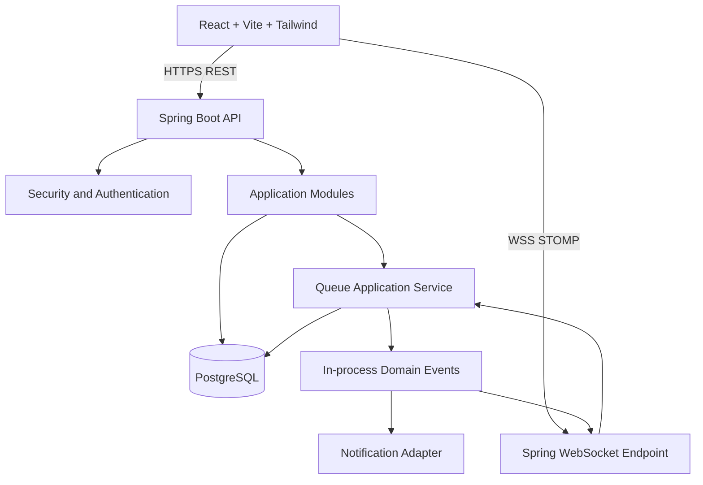
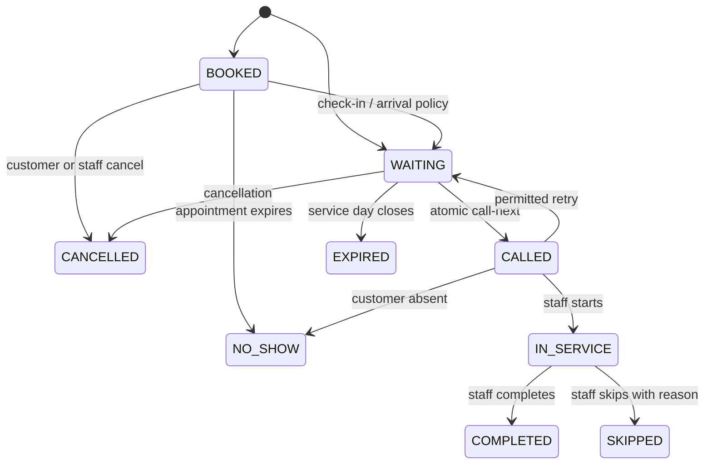

# QueueWise Technical Requirements Document

**Version:** 1.0  
**Status:** Draft  
**Source of truth:** [PRD.md](PRD.md)  
**Date:** 2026-09-17

## 1. Technical Objectives

QueueWise shall provide a production-oriented appointment, token, and real-time queue system with:

- A modular monolith that is simple to develop, deploy, test, and operate.
- PostgreSQL as the authoritative store for appointments, tokens, queue state, users, configuration, analytics source data, and audit records.
- Transactional queue state transitions that prevent duplicate calls and invalid lifecycle changes.
- REST APIs for commands and queries, and WebSocket/STOMP for low-latency queue updates.
- DTO-based API contracts, centralized validation and exception handling, secure JWT authentication, and role-based authorization.
- Containerized local and production deployment with Docker, Docker Compose, and GitHub Actions.

## 2. System Architecture

The system is a modular monolith deployed as one Spring Boot application and one React application. Modules are separated by packages and dependency rules, but run in one process and share one PostgreSQL database.



The application follows Controller -> Service -> Repository -> PostgreSQL. Entities remain inside the backend; controllers return DTOs only.

### Why a modular monolith instead of microservices

The MVP has tightly coupled transactional workflows: appointment booking creates or reserves token capacity, queue selection must atomically claim one token, counter compatibility affects queue selection, and completion feeds analytics and notifications. Splitting these flows into services would introduce network failures, distributed transactions, event delivery guarantees, service discovery, deployment coordination, and operational overhead before QueueWise has the scale or team structure to justify them.

A modular monolith provides clear boundaries and testable modules while retaining local transactions, one deployment, straightforward debugging, and low infrastructure cost. The module boundaries and DTO/event contracts leave an extraction path later if measured load, team ownership, or deployment independence requires it. Kafka, Redis, API gateways, and separate analytics or notification services are deliberately not MVP dependencies.

## 3. Backend Architecture

Recommended package root: `com.queuewise`.

- `common`: identifiers, clock, API response conventions, pagination, domain errors.
- `security`: JWT filter, authentication service, password encoder, current-user abstraction.
- `authentication`: registration, login, refresh/revocation policy, password reset boundary.
- `users`: user profile, role, scope, staff assignment.
- `services`: service catalog, hours, booking rules, duration, notification policy.
- `appointments`: slot availability, booking, cancellation, check-in, late policy.
- `tokens`: token entity, lifecycle, priority, source, history.
- `queues`: ordering policy, eligibility, starvation prevention, estimated wait, queue events.
- `counters`: counter state, compatibility, staff selection, pause/resume.
- `notifications`: templates, preferences, delivery records, provider adapter.
- `analytics`: read models or SQL projections for operational metrics and exports.
- `audit`: append-oriented audit events and scoped search.
- `web`: controllers, DTOs, mappers, and exception handlers by module.

Each module should expose application services and DTOs to other modules. It should not access another module's repositories directly. Cross-module writes use an application service or a domain event.

Typical backend classes:

- `AuthController`, `AuthService`, `JwtTokenService`, `PasswordService`.
- `ServiceController`, `ServiceManagementService`, `ServiceRepository`.
- `AppointmentController`, `AppointmentService`, `AvailabilityService`.
- `TokenController`, `TokenService`, `TokenStateTransitionService`.
- `QueueController`, `QueueEngine`, `QueueOrderingPolicy`, `WaitEstimateService`.
- `CounterController`, `CounterService`, `CounterAssignmentService`.
- `NotificationDispatcher`, `NotificationProvider`, `NotificationRepository`.
- `AnalyticsController`, `AnalyticsQueryService`.
- `AuditEventListener`, `AuditQueryService`, `AuditEventRepository`.

## 4. Frontend Architecture

React is organized by feature rather than by a single large component directory.

```text
src/
  app/                 router, providers, query client, auth bootstrap
  api/                 Axios instance, API types, error normalization
  components/          shared buttons, tables, dialogs, status views
  features/
    auth/              login, registration, session state
    customer/          services, booking, token status, history
    receptionist/      walk-in creation and arrival actions
    staff/              counter selection and queue controls
    admin/              service, counter, staff, analytics, audit screens
    queue/              queue cards, live updates, status mapping
  hooks/               feature hooks and WebSocket subscription hooks
  layouts/             customer, staff, admin layouts
  routes/              protected route and role route guards
  styles/              Tailwind entry and application styles
  types/               shared API/domain types
```

React Query owns server state, cache invalidation, loading, and error states. Local React state owns form input and transient UI state. Axios adds the access token, normalizes API errors, and handles unauthorized responses. The frontend must not duplicate queue ordering logic; it displays the server result.

## 5. Database Technology

PostgreSQL is the primary and authoritative database. Spring Data JPA with Hibernate maps entities, while Flyway or an equivalent migration mechanism should manage schema changes. The project must select one migration tool before implementation and run migrations in CI.

Core tables include `organizations`, `users`, `roles` or role columns, `services`, `service_hours`, `counters`, `counter_services`, `staff_counters`, `staff_services`, `appointments`, `tokens`, `token_events`, `queue_events`, `notification_preferences`, `notifications`, `audit_events`, and optional analytics projections.

Required database rules:

- UUID or another non-guessable identifier for public entity IDs.
- Unique organization-scoped service and counter names where required.
- Unique active token reference per organization and service date.
- Foreign keys for all owned relationships.
- Check constraints for valid priority and lifecycle values where practical.
- Indexes on organization scope, service/date, token status, priority, arrival time, counter status, and audit timestamp.
- Optimistic version columns or row locking for concurrent token and counter changes.
- No hard deletion of historical tokens, appointments, or audit events in normal operation.

## 6. Authentication Architecture

Passwords are hashed with Spring Security's adaptive password encoder, preferably BCrypt or Argon2 supported by the selected Spring Security version. Passwords are never stored or logged in plaintext.

Login validates credentials, account status, and organization scope, then issues a short-lived signed JWT access token. JWT signing keys are supplied through deployment secrets, never source code. The token contains a subject, roles, organization scope, issued time, and expiry. A refresh-token design may be added only if the client requires long sessions; refresh tokens must be revocable and stored hashed.

The backend uses a stateless `SecurityFilterChain` and JWT authentication filter. Logout invalidates a refresh token if refresh tokens are implemented; otherwise the short-lived access token expires naturally and the client removes it.

## 7. Authorization Architecture

Authorization has two layers:

1. Method/endpoint role checks, such as customer, receptionist, staff, supervisor, and admin.
2. Resource-scope checks for organization, service, counter, and assigned staff scope.

Use Spring Security method authorization for coarse checks and an application-level authorization service for resource ownership and scope. A customer can access only their own appointments and tokens. Staff can process only tokens eligible for their selected assigned counter. Admin emergency actions require an explicit reason and audit event.

## 8. API Architecture

REST APIs use versioned paths such as `/api/v1`. JSON is the default representation. Controllers accept request DTOs and return response DTOs; JPA entities never cross the API boundary.

Representative endpoints:

| Area | Endpoints |
|---|---|
| Auth | `POST /auth/register`, `POST /auth/login`, `POST /auth/logout` |
| Services | `GET /services`, `GET /services/{id}`, admin `POST/PATCH` |
| Appointments | `GET /appointments/availability`, `POST /appointments`, `GET /appointments`, `POST /appointments/{id}/cancel` |
| Tokens | `GET /tokens/{id}`, `POST /tokens/{id}/cancel`, receptionist `POST /walk-ins` |
| Queue | `GET /queues`, staff `POST /counters/{id}/call-next` |
| Service work | `POST /tokens/{id}/start`, `POST /tokens/{id}/complete`, `POST /tokens/{id}/skip` |
| Counters | admin CRUD, `POST /counters/{id}/pause`, `POST /counters/{id}/resume` |
| Admin | services, counters, staff, analytics, and audit endpoints |

Commands return the updated resource or a minimal result with its ID and state. Errors use a consistent problem response containing timestamp, status, code, message, path, and optional field errors. Sensitive implementation details are excluded.

## 9. Queue Engine Architecture

`QueueEngine` is the application service that selects the next token and owns queue transition rules. It delegates policy decisions to focused components:

- `EligibilityPolicy`: service, organization, counter compatibility, token state, appointment window, and counter availability.
- `PriorityPolicy`: urgent versus normal ordering.
- `AppointmentPolicy`: on-time, late, and walk-in treatment.
- `FairnessPolicy`: starvation threshold for normal tokens.
- `WaitEstimateService`: estimate from configured duration and eligible work.

`callNext` executes in a database transaction. It locks or claims the selected waiting token and the selected counter, rechecks eligibility, writes a token event, and publishes a queue update after the state is committed. A deterministic ordering key is required for ties. PostgreSQL row locking or an equivalent optimistic retry prevents duplicate assignment.

## 10. Appointment Architecture

`AvailabilityService` calculates bookable slots from service hours, closures, booking horizon, capacity, existing appointments, and configured duration. `AppointmentService` validates the request, creates the appointment and token reservation in one transaction, and records the event. Cancellation applies the service cutoff and updates the associated token without deleting history.

Appointment states should include `BOOKED`, `CHECKED_IN`, `LATE`, `CANCELLED`, `NO_SHOW`, and `COMPLETED` as needed by the workflow. Appointment state and token state are related but not identical: a booking does not mean the customer is physically waiting unless the configured check-in policy says so.

## 11. Token Lifecycle



Every transition is validated by `TokenStateTransitionService`, persisted with timestamps and actor, and made idempotent where clients may retry. Terminal tokens cannot return to active states except through an explicitly authorized correction workflow.

## 12. Counter Lifecycle

A counter has `INACTIVE`, `AVAILABLE`, `IN_USE`, and `PAUSED` operational states. Staff may select an available assigned counter. Selecting or releasing a counter is transactional. A paused counter cannot call new tokens, but an active service remains visible until completed or reassigned under policy. Counter compatibility is represented by a service relationship, not inferred from a UI label.

## 13. Real-Time Architecture

Spring WebSocket with STOMP provides queue updates. Clients authenticate during the WebSocket handshake or CONNECT frame using the same JWT validation rules as REST. The server authorizes subscriptions by organization and permitted service/counter scope.

Suggested destinations:

- `/topic/organizations/{organizationId}/queues/{serviceId}` for authorized queue viewers.
- `/user/queue/token-updates` for a customer's own token.
- `/topic/counters/{counterId}` for authorized staff views.

The queue transaction commits first, then publishes an in-process event to the WebSocket publisher. REST remains the source of truth; clients reconnect and refetch when a subscription is interrupted. Messages should contain event type, token/counter IDs, current state, version, and server timestamp. No queue correctness decision is made solely in the browser.

## 14. Notification Architecture

Notification creation is separated from queue state transitions through a notification application service and provider interface. The MVP may use email or SMS plus in-app status. A provider adapter translates a domain notification into provider-specific requests and records delivery status.

A provider outage must not roll back token creation or completion. Transient failures are retryable with bounded attempts; permanent failures are recorded. Notification preferences and required operational messages are evaluated before dispatch. Without Kafka, retries may use a database-backed notification status and scheduled Spring process; this remains sufficient for MVP scale.

## 15. Analytics Architecture

Analytics reads committed appointment, token, token-event, counter-session, and notification data. The MVP can use indexed PostgreSQL queries and projections rather than a separate warehouse. `AnalyticsQueryService` computes counts, average/median wait, service time, completion, cancellation, no-show, priority, source, and counter utilization by authorized scope.

If query volume later affects transactional performance, introduce versioned read projections within PostgreSQL before considering a separate analytics platform. Exports must apply the same authorization filters as the screen.

## 16. Error Handling

Use typed application exceptions such as `ResourceNotFoundException`, `ValidationException`, `ConflictException`, `ForbiddenOperationException`, `InvalidStateTransitionException`, and `ExternalProviderException`. A single `@RestControllerAdvice` maps them to consistent problem responses. Unexpected exceptions return a correlation ID and generic message while logging the server-side cause.

Transactions must roll back on failed state transitions and constraint conflicts. Retryable concurrency conflicts may be retried a small bounded number of times; the client then receives a current-state conflict response.

## 17. Validation

Validate request DTOs with Jakarta Bean Validation for required fields, formats, lengths, ranges, and passwords. Service-layer validation enforces authorization, business rules, date/time zone policy, state transitions, capacity, counter compatibility, and duplicate booking rules. Database constraints remain the final integrity boundary.

Validation errors identify field names and safe messages. Client validation improves usability but never replaces server validation.

## 18. Logging

Use structured JSON logs in deployed environments and readable logs locally. Include timestamp, level, service version, correlation ID, request ID, actor ID where safe, organization ID, endpoint, duration, outcome, and error code. Never log passwords, JWT values, refresh tokens, full personal data, or provider secrets.

Log queue transitions and administrative changes at an operational level, while audit records remain the authoritative immutable business history. Avoid logging the same event redundantly at every layer.

## 19. Security

- HTTPS in all non-local environments.
- Secure password hashing and JWT key management.
- Short access-token lifetime and revocable refresh tokens if used.
- Role and resource-scope authorization on every protected command.
- DTO validation, parameterized JPA queries, and safe error responses.
- CORS restricted to configured frontend origins.
- Rate limiting or login throttling at the application or deployment boundary.
- Secure, HttpOnly, SameSite cookie strategy if refresh tokens use cookies.
- Secrets supplied by environment or deployment secret stores.
- Audit of authentication, permissions, configuration, and token lifecycle actions.
- Dependency and container image scanning in CI.

## 20. Testing

Testing follows the module boundary and risk profile:

- **JUnit 5:** queue policies, state transitions, appointment rules, wait estimates, and authorization services.
- **Mockito:** isolated service tests for provider adapters, repositories, and external boundaries.
- **Spring Boot Test:** application wiring, transactions, security configuration, and repository integration.
- **MockMvc:** REST status codes, DTO validation, authorization, error bodies, and controller behavior.
- **PostgreSQL integration tests:** migration correctness, unique constraints, locking, and concurrent call-next behavior. Testcontainers may be used in CI if approved; it is test tooling, not runtime infrastructure.
- **Frontend tests:** component behavior, query states, form validation, and role-specific route access.
- **End-to-end smoke tests:** customer booking, walk-in processing, staff completion, and admin configuration.

Every requirement should map to at least one automated test or a documented manual acceptance test.

## 21. Configuration Management

Configuration is externalized by environment and bound to typed Spring configuration properties. Safe defaults may exist for local development, but production secrets and provider credentials must be required. Database migrations are versioned and run before the application accepts traffic.

Configurations include database URL, JWT settings, CORS origins, WebSocket limits, notification provider settings, organization time zone, logging level, retention period, and queue policy defaults. Business configuration such as services and counters belongs in PostgreSQL and is administered through the application.

## 22. Environment Variables

Example names:

```text
SPRING_PROFILES_ACTIVE
DATABASE_URL
DATABASE_USERNAME
DATABASE_PASSWORD
JWT_ISSUER
JWT_SECRET or JWT_PRIVATE_KEY
JWT_ACCESS_TOKEN_MINUTES
CORS_ALLOWED_ORIGINS
APP_TIME_ZONE
MAIL_HOST
MAIL_PORT
MAIL_USERNAME
MAIL_PASSWORD
SMS_PROVIDER_URL
SMS_PROVIDER_KEY
LOG_LEVEL_ROOT
```

Secrets must not be committed to Git, Docker images, frontend bundles, or logs. The frontend receives only non-secret public configuration such as API base URL and WebSocket URL.

## 23. Docker Architecture

Local Compose should run only the necessary services:

- `postgres`: PostgreSQL with a named development volume and health check.
- `backend`: Spring Boot application built from a multi-stage Maven image.
- `frontend`: Vite production build served by a small web server image, or the frontend dev server locally.

The backend waits for PostgreSQL health, applies migrations, and exposes its HTTP and WebSocket endpoint. Production may use managed PostgreSQL rather than running the database container. No Redis, Kafka, service mesh, or API gateway is required for the MVP.

## 24. Deployment Architecture

The MVP can deploy one backend container, one frontend container, and managed PostgreSQL behind HTTPS. WebSocket upgrade support must be enabled at the reverse proxy or hosting boundary. Backend instances may begin as one replica; if scaled horizontally, WebSocket session routing and cross-instance event delivery must be designed before enabling multiple replicas. PostgreSQL remains the consistency boundary.

A deployment should include health endpoints for startup and readiness, migration handling, resource limits, encrypted transport, secret injection, and rollback to the previous application image.

## 25. CI/CD

GitHub Actions should run on pull requests and protected branch changes:

1. Check formatting and compile with Java 25 and Maven.
2. Run unit, MockMvc, repository, and integration tests.
3. Build the frontend and run frontend tests/lint.
4. Run dependency, secret, and container scans.
5. Build versioned backend and frontend images.
6. Publish images only from approved branches/tags.
7. Deploy to a controlled environment with migration and smoke-test steps.
8. Require review and passing checks before production.

CI must fail on test failure, compilation failure, migration failure, exposed secret, or critical security finding according to the project's policy.

## 26. Performance Considerations

Use indexes for active queue lookup, service/date availability, organization scope, token status, and audit time. Keep queue selection queries narrow and lock only the rows required. Use pagination for history, audit, analytics detail, and service lists. Avoid N+1 JPA queries and unbounded collection fetching.

Cache only low-risk configuration reads if measurement justifies it; correctness-critical queue state is read from PostgreSQL. Use database connection pooling with bounded settings. Measure p95 API response time, queue update latency, transaction duration, slow queries, and notification processing time.

## 27. Scalability Considerations

The modular monolith scales vertically and can scale horizontally when the database and WebSocket event strategy support it. Organization-scoped indexes and pagination allow many organizations without loading global queues into memory. Queue state remains database-backed, so process restarts do not lose tokens.

Do not introduce distributed infrastructure preemptively. Consider Redis, Kafka, a read replica, or extracted services only after measured bottlenecks, traffic volume, or deployment ownership justify the operational cost and consistency design.

## 28. Observability

Expose health, readiness, application version, database connectivity, migration status, queue event latency, notification failure count, active WebSocket sessions, API error rate, p95 latency, and database pool saturation. Use correlation IDs across REST requests, queue transitions, WebSocket messages, and notifications.

Alerts should cover application unavailability, database failure, high queue transition conflict rate, notification backlog, error-rate spikes, and slow queries. Metrics must avoid high-cardinality labels containing customer identifiers.

## 29. Backup and Recovery Considerations

PostgreSQL backups are the primary recovery mechanism. Production requires automated encrypted backups, a tested retention policy, and periodic restore verification. Define a recovery point objective and recovery time objective before production launch; an initial MVP target should be agreed with the operating organization rather than assumed.

Audit and token history must be included in backups. Deployment artifacts and migration files must be versioned so a restored database can be brought forward safely. Recovery runbooks must cover database restore, secret restoration, migration verification, application rollback, and WebSocket reconnection behavior.
